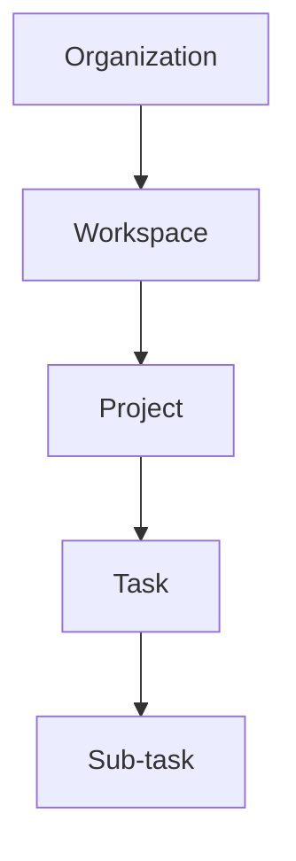
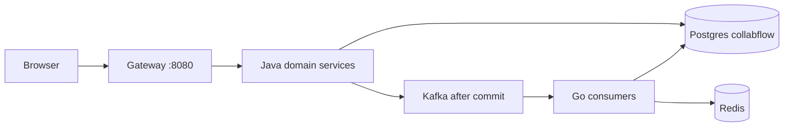

# 00 — Big picture

**Goal:** See what CollabFlow is, who uses it, and how the monorepo splits the work.

## What it is

CollabFlow is a multi-tenant collaboration and project management system. A tenant is an **organization**. Inside an organization, people work in **workspaces**, then **projects**, then **tasks**. Sub-tasks are tasks that point at a parent task. The hierarchy is not flattened: an API or a table does not skip a level.

The root [README.md](../../README.md) describes the portfolio shape: Java owns the synchronous domain (identity, tenancy, tasks). Go owns asynchronous side effects (notifications, comments, activity, live updates, mail, files). One PostgreSQL database named `collabflow` is shared for the MVP. Redis and Kafka sit beside it.

## Who uses it

| Person | What they do | Where it lives |
|--------|----------------|----------------|
| Master admin | Creates users and organizations, attaches members, reads audit and flags | `users.is_master_admin`, checked in service code. UI routes under `frontend/app/(admin)/` |
| Member | Picks an organization, then works in workspaces, projects, tasks, comments | Product routes under `frontend/app/(app)/`. Header `X-Organization-Id` after org pick |
| Invitee | Opens a token link, then accepts while signed in | `GET /api/v1/invitations/token/{token}` is public; accept needs a JWT |

A master admin is a flag on the user row, not an organization role. Organization roles (Owner, Admin, Member) live in `roles` and member tables owned by platform-service. [docs/fe-contract.md](../fe-contract.md) describes the product story: admin provisions the tenant, the member verifies email, then picks an organization.

## Hierarchy



| Level | Table | Owning service |
|-------|--------|----------------|
| Organization | `organizations`, `organization_members` | platform-service |
| Workspace | `workspaces`, `workspace_members` | platform-service |
| Project | `projects`, `project_members` | platform-service |
| Task | `tasks` (also `sprints`, workflows) | task-service |

Confirmed in [docs/database.md](../database.md) ownership section and the Flyway files under each Java service.

## How the monorepo fits

```
CollabFlow_V2/
  backend/java-services/   auth, user, platform, task, api-gateway, common
  backend/go-services/     collab, realtime, document, email
  backend/infrastructure/  Docker Compose
  frontend/                Next.js caller of the gateway
  docs/                    contracts (this folder is a reading guide)
  scripts/                 dev-backend start/stop
  postman/                 collections
```

The browser talks only to **api-gateway** on port **8080**. The gateway forwards `/api/v1/...` to the service that owns that path. Route list: `backend/java-services/api-gateway/src/main/resources/application.yml` and [docs/services-mvp.md](../services-mvp.md).

## Six MVP services, plus three Phase 2 processes

[docs/services-mvp.md](../services-mvp.md) still calls the original set “6 services”. The Gradle build and Compose startup also run three Phase 2 processes. All nine are in the tree today.

| Service | Language | Port | Owns |
|---------|----------|------|------|
| api-gateway | Java | 8080 | Routing, `X-API-Key`, JWT on protected routes |
| auth-service | Java | 8081 | Users schema, refresh tokens, email tokens, JWT issue |
| platform-service | Java | 8082 | Orgs, workspaces, projects, RBAC, admin console |
| task-service | Java | 8083 | Workflows, tasks, sprints |
| user-service | Java | 8084 | Profile and admin user directory on the shared `users` table |
| collab-service | Go | 9081 | Notifications, invitations, comments, activity |
| realtime-service | Go | 9082 | WebSocket rooms, Redis pub/sub |
| document-service | Go | 9083 | File metadata in Postgres, bytes on disk |
| email-service | Go | 9084 | Consumes `email.send` and sends SMTP. No gateway route |

Versions (from [docs/tech-stack.md](../tech-stack.md), checked against build files): Java 21, Spring Boot 4.1.1, Gradle 8.14.3, Spring Cloud 2025.1.3 on the gateway, Go 1.27, Gin 1.12.0, PostgreSQL 17, Redis 8, Kafka via Confluent Platform 7.9.2, Next.js 16.4.2.

## Two ways a change moves

**Synchronous HTTP.** The caller needs an answer now. Example: create a task. The browser calls the gateway, task-service writes Postgres, and the HTTP response returns the new task.

**Asynchronous Kafka.** Side effects happen after the database write succeeds. Java publishers use `@TransactionalEventListener(phase = AFTER_COMMIT)`. Example: after a task is assigned, task-service publishes `task.assigned`. collab-service inserts a notification. The HTTP response does not wait for that insert.

Shared Postgres is an MVP choice. Services are not given separate databases. Cross-service reads of shared tables are allowed (collab and realtime read `users` and membership tables). Writes stay with the owner: collab does not insert `organization_members`; invitation accept calls platform-service over HTTP.



## Glossary

| Term | Meaning |
|------|---------|
| ApiId | A short id such as `TASK-001` on a Java handler. It is for logs, not an HTTP error code. |
| JWT | Signed access token. Subject (`sub`) is the user id. |
| Master admin | `users.is_master_admin`. Separate from org Owner/Admin/Member. |
| Envelope | JSON shape `{ success, message, data, timestamp }` from `ApiResponse`. |
| Shared DB | One Postgres database used by every service that stores data. |

## Unverified

Nothing in this chapter is unverified. Ports and ownership match [docs/services-mvp.md](../services-mvp.md), [docs/running.md](../running.md), and the gateway `application.yml`.
