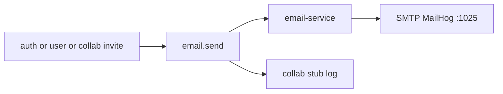
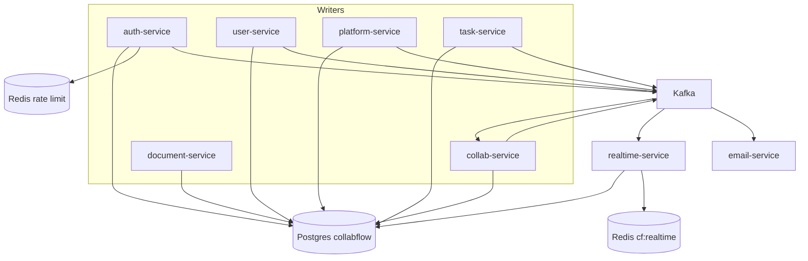

# 02 — Data stores

**Goal:** See which process talks to Postgres, Redis, and Kafka, and when a message is allowed to leave the service.

## Shared Postgres

Engine: PostgreSQL 17 (`postgres:17-alpine` in `backend/infrastructure/docker-compose.yml`). Database name: `collabflow` ([docs/tech-stack.md](../tech-stack.md), `.env.example` name `POSTGRES_DB`). Schema: default `public`. There is no database per service.

JDBC URL pattern in the Java `application-dev.yml` files:

`jdbc:postgresql://${POSTGRES_HOST:localhost}:${POSTGRES_PORT:5432}/${POSTGRES_DB:collabflow}`

Go services build a DSN from the same `POSTGRES_*` names (`collab-service/internal/config`, and the same pattern in realtime and document).

| Service | Connects? | How schema changes |
|---------|-----------|--------------------|
| auth-service | Yes | Flyway. History table `flyway_schema_history` (Flyway default). |
| user-service | Yes | No Flyway. JPA `ddl-auto: validate` against the auth-owned `users` table. |
| platform-service | Yes | Flyway history table `flyway_platform_history`. |
| task-service | Yes | Flyway history table `flyway_task_history`. |
| collab-service | Yes | GORM `AutoMigrate` in `internal/database/db.go`. |
| document-service | Yes | GORM `AutoMigrate` of `model.Document` only. |
| realtime-service | Yes, read-only | `database.Connect` opens the DB and does not migrate. ACL queries in `internal/acl/membership.go`. |
| api-gateway | No | — |
| email-service | No | SMTP and Kafka only (`email-service/cmd/server/main.go`). |

Three Flyway histories exist because three Java services migrate the same database. They must not reuse one `flyway_schema_history` table or version numbers would collide. Auth must migrate before user-service starts, because user-service only validates.

### Flyway files

| File | What it does |
|------|----------------|
| `auth-service/.../V1__create_users_and_refresh_tokens.sql` | `users`, `refresh_tokens` |
| `auth-service/.../V2__auth_phase2_admin_and_tokens.sql` | `users.is_master_admin`, `email_tokens` |
| `auth-service/.../V3__admin_user_lifecycle.sql` | `users.deleted_at`, `users.last_login_at` |
| `platform-service/.../V1__create_roles_and_permissions.sql` | `roles`, `permissions`, `role_permissions` plus org role seed |
| `platform-service/.../V2__create_organizations.sql` | `organizations`, `organization_members` |
| `platform-service/.../V3__create_workspaces.sql` | workspace roles, `workspaces`, `workspace_members` |
| `platform-service/.../V4__create_projects.sql` | project roles, `projects`, `project_members` |
| `platform-service/.../V5__admin_platform.sql` | `admin_audit_events`, `announcements`, `feature_flags` |
| `task-service/.../V1__create_workflows_and_tasks.sql` | workflows, statuses, transitions, `task_types`, `tasks`; seeds `task.*` permissions |
| `task-service/.../V2__create_sprints.sql` | `sprints`, foreign key from `tasks.sprint_id`, `sprint.*` permissions |

Collab tables are not in Flyway. `collab-service/internal/database/db.go` migrates `notifications`, `processed_events`, `invitations`, `comments`, `comment_mentions`, `activity_feed`.

`documents` is migrated by document-service at startup, not by Flyway. [docs/database.md](../database.md) still lists `documents` under “design-only / not migrated”. The code disagrees. See chapter 03.

### Who writes vs who reads

| Table family | Writer | Other readers |
|--------------|--------|----------------|
| `users`, `refresh_tokens`, `email_tokens` | auth-service (schema and credentials). user-service writes profile and admin-create fields on `users`. | platform `UserRef`, collab `UserRef`, document and realtime only as needed for ACL |
| Org / workspace / project / roles | platform-service | task-service (membership and project scope), realtime ACL, document `project_members` count |
| Workflows, tasks, sprints | task-service | realtime reads `tasks` for room ACL. collab may read `tasks` as a projection. |
| Comments, notifications, invites, activity, `processed_events` | collab-service | — |
| `documents` | document-service | — |
| `admin_audit_events` | platform owns the table. auth and user-service insert rows. platform reads them. | — |

[docs/database.md](../database.md) says cross-service reads are acceptable. Prefer putting ids in Kafka payloads instead of joining widely across owners.

Passwords and API keys are not stored in these notes. Postgres credentials are the `POSTGRES_USER` and `POSTGRES_PASSWORD` variables. They are present in `.env.example` as placeholders. Do not copy them into chat or docs.

## Redis

Image: `redis:8-alpine`. Host port 6379.

| Service | Use | Detail |
|---------|-----|--------|
| auth-service | Login and register rate limit | `AuthRateLimiter` keys `rate_limit:auth:{action}:{clientKey}`. Actions include `login`, `register`, `refresh`, `resend_verify`, `forgot_password`. `INCR` plus TTL. If Redis is down: fail-open when the profile is `dev`, `local`, or unset; fail-closed otherwise (`AuthRateLimiter.isDevLike`). |
| realtime-service | Pub/sub bus | Channel prefix `cf:realtime:` in `internal/redisx/pubsub.go`. Publish `cf:realtime:{room}`. Subscribe with `PSUBSCRIBE cf:realtime:*`. The local hub then writes to WebSocket clients. |
| collab, document, email, gateway, platform, task, user | None | — |

Realtime needs Redis so more than one realtime process can share a broadcast. Kafka is consumed by one instance in a group; that instance publishes to Redis; every instance subscribed to the pattern delivers to its own sockets. With one local process the path is the same, just shorter.

`REDIS_PASSWORD` is optional in the realtime config. Leave it unset for the Compose image, which does not set a password in the compose file reviewed here.

## Kafka

Broker: `confluentinc/cp-kafka:7.9.2` (Apache Kafka 3.9.x) with ZooKeeper `cp-zookeeper:7.9.2`. [docs/tech-stack.md](../tech-stack.md) keeps ZooKeeper on purpose. Kafka 4 drops it. Host port 9092. Apps use `KAFKA_BOOTSTRAP_SERVERS` (example default `localhost:9092`).

### Envelope

Java record `com.collabflow.common.kafka.DomainEvent`:

| Field | Meaning |
|-------|---------|
| `eventId` | New UUID string per message |
| `eventType` | Usually the topic name |
| `timestamp` | `Instant` when the event object is built |
| `version` | Constant `"1.0"` |
| `data` | Payload object |

Go consumers decode the same shape. Realtime’s `Envelope` reads `eventId`, `eventType`, and `data` (`realtime-service/internal/kafka/consumer.go`). Collab’s envelope matches, including a `payload` alias in some decoders. Email uses `to`, `subject`, `body`, `template`, `correlationId` inside `data`.

### When a message is sent

Java publishers listen with `@TransactionalEventListener(phase = TransactionPhase.AFTER_COMMIT)`. If the database transaction rolls back, the listener does not run. Confirmed on:

- `auth-service` `UserCreatedKafkaPublisher`, `EmailSendKafkaPublisher`
- `user-service` publishers for `user.created`, `user.updated`, `email.send`
- `platform-service` organization, workspace, and project publishers
- `task-service` `TaskKafkaPublisher`

Go collab publishes `comment.added` and invitation `email.send` from the service after the row write (`CommentService.Create`, `InvitationService.publishInvitationEmail`). That is the Go equivalent of “after a successful write”.

Publishing is not part of the HTTP transaction. `TaskKafkaPublisher.publish` logs an error if `kafkaTemplate.send` fails. The HTTP call can still have returned success. That is the tradeoff of after-commit events.

### Topics

| Topic | Producer | Consumer in this repo |
|-------|----------|------------------------|
| `user.created` | auth `UserCreatedKafkaPublisher` (public register); user-service (admin create) | None on purpose. Account mail is `email.send`. |
| `user.updated` | user-service | None on purpose. A profile change has no organization to attach. |
| `email.send` | auth (verify and reset), user-service (welcome), collab invitations | email-service always. collab stub consumer only when `EMAIL_SERVICE_ENABLED` is not true (`collab-service/cmd/server/main.go`). |
| `organization.created`, `.updated`, `.deleted`, `.member_added`, `.member_removed` | `OrganizationKafkaPublisher` | collab activity (`ORGANIZATION_*` or `MEMBER_JOINED` / `MEMBER_LEFT`) |
| `workspace.*` (same five suffixes) | `WorkspaceKafkaPublisher` | collab activity |
| `project.*` (same five suffixes) | `ProjectKafkaPublisher` | collab activity. Payloads include `organizationId`. |
| `task.created` | `TaskKafkaPublisher` | collab → activity |
| `task.updated` | `TaskKafkaPublisher`. Also published on status change, assign, and sprint attach/detach (`TaskServiceImpl`, `SprintServiceImpl`) | realtime → Redis rooms `project:{id}` and `task:{id}` |
| `task.deleted` | `TaskKafkaPublisher`. Payload includes org, workspace, name, and `actorId` copied before the row is deleted. | collab activity (`TASK_DELETED`, payload only) and realtime room `project:{id}` |
| `task.assigned` | `TaskKafkaPublisher` | collab → notification and activity (`FanOutAssigned`) |
| `task.status_changed` | `TaskKafkaPublisher`. Payload adds `actorId`, org, workspace, and name. Status still also publishes `task.updated`. | collab activity plus a `TASK_UPDATED` notification when the assignee is not the actor; realtime rooms `project:{id}` and `task:{id}` |
| `comment.added` | collab `CommentService` | collab activity consumer, and realtime |

Consumer group defaults: collab `collab-service` (`KAFKA_GROUP_ID`), realtime `realtime-service`, email `email-service` or `EMAIL_KAFKA_GROUP_ID`. Readers use `StartOffset: LastOffset`, so a consumer that starts late does not replay the backlog ([docs/fe-contract.md](../fe-contract.md) ops note).

Collab idempotency: `processed_events` keyed by `event_id`. Activity uses `eventId + ":activity"` so the same Kafka event can record both a notification and an activity row. email-service does not write `processed_events`. A redelivered `email.send` can send mail twice.

### Mail path

Only one of the two consumers should run. With `EMAIL_SERVICE_ENABLED=true`, collab skips its `email.send` reader and email-service sends plain text. The template name is an `X-Template` header, not an HTML renderer (`email-service/internal/smtp/send.go`).

Task-assigned “email” inside `NotificationService` calls `email.StubSend` in process. That path does not publish `email.send`.

## Diagram

## Glossary

| Term | Meaning |
|------|---------|
| Flyway | Versioned SQL run by a Java service on startup. |
| AutoMigrate | GORM creates or alters tables from Go structs. |
| After commit | Kafka publish runs only if the DB transaction commits. |
| Consumer group | Kafka’s way of sharing a topic among instances. One group name per service. |

## Unverified

Compose healthcheck timings were summarized from `docker-compose.yml` during exploration (Postgres `pg_isready`, Redis ping, Kafka broker API). The image tags and ports were confirmed in that file and in [docs/running.md](../running.md). Exact `application-dev.yml` Flyway `table:` lines for platform and task were reported by exploration and match the names in [docs/database.md](../database.md); if you change a history table name, re-read those YAML files.
