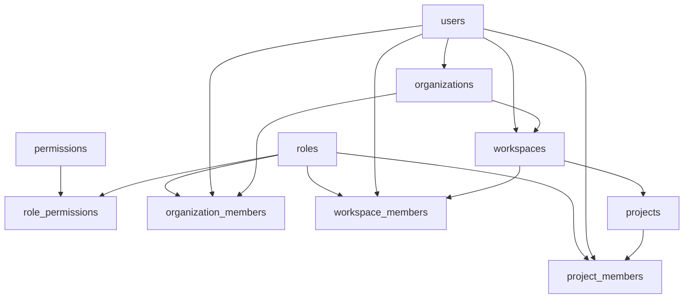
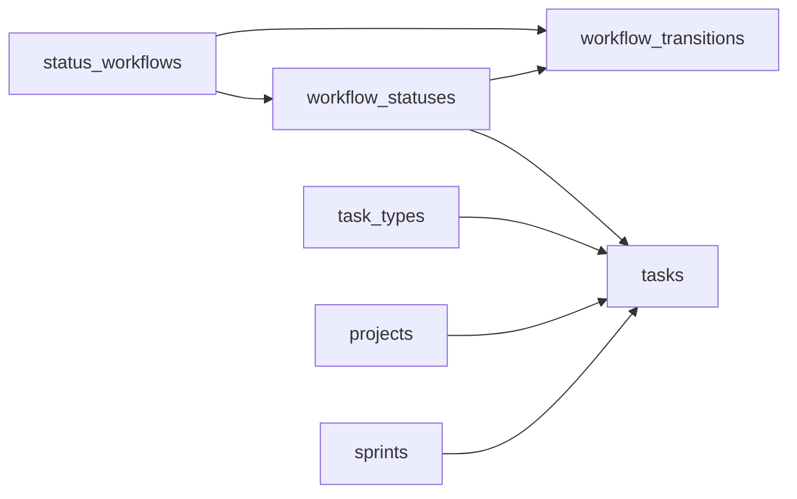

# 03 — Data model

**Goal:** Know the shipped tables, who owns them, and how the hierarchy links together.

Column lists below follow [docs/database.md](../database.md) for tables that Flyway or GORM actually create. Design-only tables are listed once at the end so they are not mistaken for the live schema. Primary keys are UUIDs. Timestamps in the SQL migrations are `TIMESTAMPTZ`.

## Ownership

| Owner | How | Tables |
|-------|-----|--------|
| auth-service | Flyway V1–V3 | `users` (schema), `refresh_tokens`, `email_tokens` |
| user-service | Shared table, no migration | Writes profile and admin fields on `users` |
| platform-service | Flyway V1–V5 | `roles`, `permissions`, `role_permissions`, `organizations`, `organization_members`, `workspaces`, `workspace_members`, `projects`, `project_members`, `admin_audit_events`, `announcements`, `feature_flags` |
| task-service | Flyway V1–V2 | `status_workflows`, `workflow_statuses`, `workflow_transitions`, `task_types`, `tasks`, `sprints` |
| collab-service | GORM AutoMigrate | `notifications`, `invitations`, `comments`, `comment_mentions`, `activity_feed`, `processed_events` |
| document-service | GORM AutoMigrate | `documents` |
| realtime-service, api-gateway, email-service | — | No tables |

Task-service also inserts `task.*` and `sprint.*` rows into platform’s `permissions` tables. Roles stay owned by platform.

## Identity

### `users`

Login and profile share one row. Auth Flyway owns the columns. user-service maps them.

| Column | Role |
|--------|------|
| `id` | JWT subject |
| `email` | Unique login |
| `password` | Hash. Never returned in API docs or logs. |
| `name`, `avatar_url`, `phone`, `bio` | Profile |
| `is_active` | Suspended accounts fail login |
| `is_email_verified` | Login requires this, except a master admin (`AuthServiceImpl.login`) |
| `is_master_admin` | Admin console, not an org role |
| `deleted_at` | Soft delete. Email stays unique until restore. |
| `last_login_at` | Set on successful login |
| `created_at`, `updated_at` | |

### `refresh_tokens`

One row per refresh token. `user_id` cascades on user delete. `token` is unique. `expires_at`, `is_revoked`, `revoked_at`. Refresh rotates: the old row is revoked, a new one is inserted (`AuthServiceImpl.refresh`).

### `email_tokens`

One-time tokens. `purpose` is `VERIFY_EMAIL` or `RESET_PASSWORD`. `used_at` marks consumption. `user_id` cascades.

## Tenancy and RBAC

### `organizations`

`name`, unique `slug`, `owner_id` → `users`, `plan` (`FREE`, `PRO`, `ENTERPRISE`), `max_members`, `max_workspaces`, `is_active`, description and logo. Soft deactivate is `is_active = false`, not a hard delete, for the admin deactivate API.

### Member tables

`organization_members`, `workspace_members`, and `project_members` share the same idea: `id`, parent id, `user_id`, `role_id`, `joined_at`. Unique on `(parent, user)`. Workspace and org members also have `last_active_at` in the catalog.

A user must be an organization member before workspace or project membership makes sense. Invitation accept creates those rows through platform HTTP, not by collab inserting them.

### `roles`, `permissions`, `role_permissions`

`roles.scope` is `ORGANIZATION`, `WORKSPACE`, or `PROJECT`. Seeded names in the catalog include Owner, Admin, and Member at org scope, and Admin, Member, and Viewer at workspace and project scope. `permissions.name` looks like `task.create`. `role_permissions` is the many-to-many. `PermissionService` in platform and task reads this graph. There is no permission flag column on the member row.

### `workspaces`

Belongs to `organization_id`. `owner_id`, unique `invite_code`, `time_zone`, `date_format`, `is_active`.

`default_workflow_id` is a nullable UUID. [docs/database.md](../database.md) describes a foreign key to `status_workflows`. `platform-service/.../V3__create_workspaces.sql` does **not** add that foreign key. The SQL comment says the key waits until task-service exists. The column is still a logical pointer.

`owner_id` in that same migration is `ON DELETE CASCADE`. The narrative in `database.md` is looser. Trust the migration.

### `projects`

Belongs to `workspace_id`. Optional `parent_project_id` for nesting. `owner_id`, `lead_id`, `status` (`ACTIVE`, `ARCHIVED`, `ON_HOLD`), `project_type` (`SOFTWARE`, `MARKETING`, `HR`, `CUSTOM`), dates.

`workflow_id` is a nullable UUID **without** a foreign key (`V4__create_projects.sql`), same disagreement as the workspace workflow column. `owner_id` is `ON DELETE CASCADE` in V4.

## Work and tasks

| Table | Key columns |
|-------|-------------|
| `status_workflows` | `name`, optional `workspace_id` (null means a global template), `is_default`, `is_template` |
| `workflow_statuses` | `workflow_id`, `name`, `display_order`, `color`, `category` (`TODO`, `IN_PROGRESS`, `DONE`) |
| `workflow_transitions` | `from_status_id`, `to_status_id`, `require_comment`. Unique per workflow and pair. |
| `task_types` | `name`, `workspace_id`, `is_system`, optional `default_status_id` |
| `tasks` | `name`, `project_id`, `workspace_id`, `organization_id`, `status_id`, `assignee_id`, `reporter_id`, `parent_task_id`, `priority` (`LOW`, `MEDIUM`, `HIGH`, `CRITICAL`), `position`, dates, `story_points`, `sprint_id` |
| `sprints` | `project_id`, `sprint_number`, `start_date`, `end_date`, `status` (`PLANNING`, `ACTIVE`, `COMPLETED`, `CANCELLED`), `goal` |

`tasks.sprint_id` is a real foreign key added in task Flyway V2. Sub-tasks use `parent_task_id`.

Task-service checks the caller is a member of the organization in `X-Organization-Id` before these handlers run (`TaskController` calls `OrganizationContextService.requireMembership`). Project-level permission checks live in `PermissionService` inside the service methods. This chapter does not restate every permission name; the seeds are in the task migrations.

## Collaboration

Owned by collab-service structs, not Flyway. Shapes match the catalog sections in [docs/database.md](../database.md).

| Table | Purpose | Important columns |
|-------|---------|-------------------|
| `comments` | Thread on an entity | `content`, `entity_type` (`TASK`, `PROJECT`, `DOCUMENT`), `entity_id`, `author_id`, `parent_comment_id` |
| `comment_mentions` | Parsed mentions | `comment_id`, `mentioned_user_id`. Unique pair. |
| `notifications` | Inbox | `recipient_id`, `notification_type`, `title`, `message`, `entity_type`, `entity_id`, `organization_id`, `is_read` |
| `activity_feed` | Timeline | `action_type`, `entity_type`, `entity_id`, `organization_id`, `user_id`, `changes` JSON |
| `invitations` | Email invite | `email`, `organization_id`, optional `workspace_id` and `project_id`, `invitation_type`, `status`, unique `token`, `expires_at` |
| `processed_events` | Consumer idempotency | Primary key `event_id`, plus topic and time |

Mentions in code are UUID tokens of the form `@<uuid>` (`CommentService` `mentionPattern`), not `@username`. The catalog note that says “parse @username” is the older description. Trust the regex in `comment_service.go`.

`COMMENT_MENTION` notifications are written in the same request as the comment, not by a second Kafka consumer. `comment.added` is still published for activity and realtime.

## Documents

`document-service/internal/model/document.go` maps table `documents`:

| Column | Role |
|--------|------|
| `id` | Also the on-disk file name |
| `name`, `description` | Display name |
| `file_path` | Stored as the UUID string, not a full path |
| `file_type`, `file_size` | From the upload |
| `entity_type`, `entity_id` | `PROJECT`, `TASK`, `WORKSPACE`, or `COMMENT` |
| `uploaded_by` | JWT user |
| `version`, `parent_document_id`, `is_latest` | New upload of the same name bumps version and clears `is_latest` on the previous row |

Bytes live under `DOCUMENT_STORAGE_DIR` (default `data/documents`). [docs/database.md](../database.md) still says not to create `documents` until a later phase, and it also describes `document_folders`, `document_permissions`, and `document_tags`. Only `documents` is created by AutoMigrate. The other three are not in the Go model.

Download (`DocumentHandler.Content`) only streams rows with `entity_type = PROJECT`. Other entity types can be stored and then refused on download.

## Admin console tables

| Table | Key columns |
|-------|-------------|
| `admin_audit_events` | `actor_user_id`, `action`, `target_type`, `target_id`, `metadata` JSON, `ip_address`, `created_at`. Passwords are not stored here. |
| `announcements` | `title`, `body`, `is_active`, `starts_at`, `ends_at`, `created_by` |
| `feature_flags` | Primary key `key`, `enabled`, `description`. A missing key is treated as enabled (`FLAG-001` in [docs/services-mvp.md](../services-mvp.md)). |

## Access checks in plain words

| Check | Where | What it asks |
|-------|--------|----------------|
| Org header membership | `task-service` `OrganizationContextService.requireMembership` | Is this user in `organization_members` for `X-Organization-Id`? |
| Permission name | platform and task `PermissionService` | Does this user’s role at that scope include `task.update` (and similar)? |
| Project file access | `DocumentHandler.isProjectMember` | `SELECT COUNT(*) FROM project_members WHERE project_id = ? AND user_id = ?` |
| WebSocket room | `realtime-service/internal/acl/membership.go` `Checker.AllowSubscribe` | `org:` requires `organization_members`. `project:` requires `project_members` or, if not, any org member of the project’s organization. `task:` resolves `tasks.project_id` and uses the same project rule. `user:` only if the id is the JWT subject. If `X-Organization-Id` is present, the room’s org must match. |

The project fallback (any org member, not only `project_members`) is written in `canAccessProject`. Document download does **not** use that fallback. It requires a `project_members` row.

## Design-only (not created by Flyway or the Go models opened here)

From the ownership section of [docs/database.md](../database.md):

| Area | Tables |
|------|--------|
| Platform | `tags` |
| Task extras | `watchers`, `custom_fields`, `custom_field_options`, `task_type_custom_fields`, `task_custom_field_values`, `task_dependencies`, `task_tags` |
| Collab extras | `comment_attachments`, `comment_reactions` |
| Documents extras | `document_folders`, `document_permissions`, `document_tags` |

Later sections of `database.md` still describe `watchers` as task-owned and `documents` as Phase 2. The ownership table at the top is the one that matches Flyway. `documents` itself is the exception: the Go service creates it.

## Doc versus code

| Topic | Doc | Code |
|-------|-----|------|
| `documents` | Design-only in the ownership table | `AutoMigrate(&model.Document{})` |
| `workspaces.default_workflow_id`, `projects.workflow_id` | Foreign keys | Nullable UUID, no FK, comment in V3 and V4 |
| `workspaces.owner_id`, `projects.owner_id` | Catalog is less specific | `ON DELETE CASCADE` in V3 and V4 |
| Mention parsing | Catalog says `@username` | Code matches `@` plus a UUID |
| Permission catalog | Full `document.*` examples in the permissions chapter | Migrations seed the permissions the shipped scopes need, not every example line |

## Glossary

| Term | Meaning |
|------|---------|
| Scope | Whether a role applies to an organization, a workspace, or a project. |
| Soft delete | `deleted_at` or `is_active = false` instead of removing the row. |
| Latest file | `documents.is_latest` marks the current version of a name on an entity. |

## Unverified

Individual GORM struct tags for `comments` and `notifications` were not re-opened field by field. The table list comes from `collab-service/internal/database/db.go` `AutoMigrate` (via the service survey) and the column meanings come from [docs/database.md](../database.md). If a GORM tag omits a catalog column, the live table can differ. Confirm in `internal/model` before you write SQL against a collab table.
