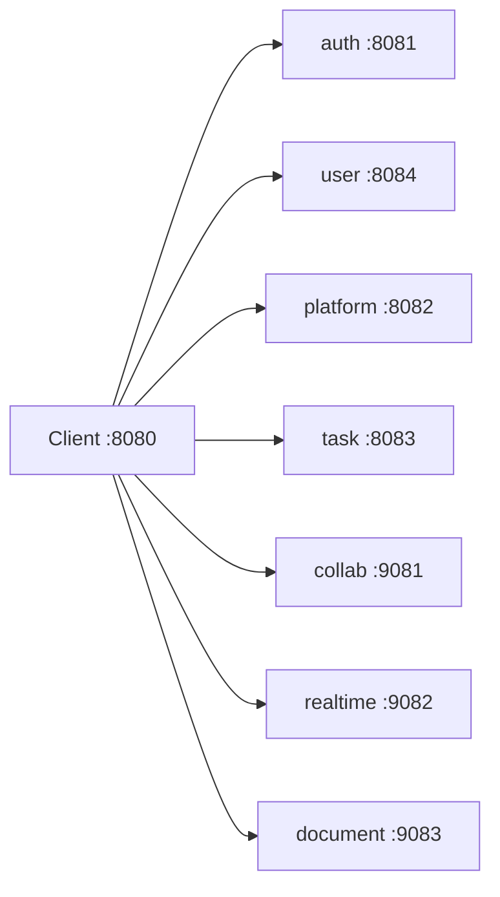

# 04 — APIs

**Goal:** Find the gateway route, the ApiId, the headers, and the auth rule for a call.

The catalog of ids lives in [docs/services-mvp.md](../services-mvp.md). Java handlers carry `@ApiId`. Go ids in that file are documentation ids. There is no `@ApiId` annotation in Go.

Paths below are the public paths on port **8080**. The gateway strips nothing; the same path is forwarded to the downstream service.

## Headers

| Header | When | Enforced by |
|--------|------|-------------|
| `X-API-Key` | Every `/api/**` request except `OPTIONS` | `ApiKeyGatewayFilter` at the edge. Servlet services also run `ApiKeyFilter` from `:common` if you call them directly. |
| `Authorization: Bearer <accessToken>` | Any route that is not public | Gateway `GatewaySecurityConfig` (HS256, secret `JWT_SECRET`). Downstream filters read `sub` as the user UUID. |
| `X-Organization-Id` | Product calls after org pick | `OrgHeaderGatewayFilter` forwards it. Task handlers require it (`@CurrentOrganizationId` plus `requireMembership`). Platform mostly uses the id in the path. Collab treats it as optional on many list routes. |

WebSocket upgrades cannot always set headers. Realtime accepts `?token=` and the gateway accepts `?apiKey=` on `/api/v1/realtime/ws` (`ApiKeyGatewayFilter`). [docs/fe-contract.md](../fe-contract.md) shows:

`ws://localhost:8080/api/v1/realtime/ws?token=<accessToken>&apiKey=<API_KEY>`

The gateway does **not** require a JWT on that path (`permitAll` in `GatewaySecurityConfig`). realtime-service checks the token.

## Gateway route map

From `api-gateway/src/main/resources/application.yml`. First match wins. The auth-admin route is listed before the user-service wildcard so deactivate and session routes stay on auth.

| Route id | Path predicate | Default URI |
|----------|----------------|-------------|
| auth-service | `/api/v1/auth/**` | `http://localhost:8081` |
| auth-admin | `/api/v1/admin/users/*/deactivate`, `.../activate`, `.../sessions/revoke`, `.../reset-password`, `.../resend-verification`, `/api/v1/admin/sessions/**` | `:8081` |
| user-service | `/api/v1/users/**`, `/api/v1/admin/users/**` | `:8084` |
| platform-service | `/api/v1/organizations/**`, `/roles/**`, `/workspaces/**`, `/projects/**`, `/platform/**`, `/admin/organizations/**`, `/admin/announcements/**`, `/admin/feature-flags/**`, `/admin/audit/**`, `/admin/stats`, `/announcements/**`, `/feature-flags/**` | `:8082` |
| task-service | `/api/v1/tasks/**`, `/workflows/**`, `/task-types/**`, `/sprints/**` | `:8083` |
| collab-service | `/api/v1/notifications/**`, `/collab/**`, `/invitations/**`, `/comments/**`, `/activity/**` | `:9081` |
| realtime-service | `/api/v1/realtime/**` | `:9082` |
| document-service | `/api/v1/documents/**` | `:9083` |

email-service has **no** gateway route. Call `GET http://localhost:9084/api/v1/email/health` directly.

## What is public

`GatewaySecurityConfig` `permitAll` (API key still required on `/api/**` except `OPTIONS`):

| Path | Notes |
|------|--------|
| `POST /api/v1/auth/register` | Also blocked inside auth when public register is off |
| `POST /api/v1/auth/login`, `/refresh`, `/logout` | |
| `POST /api/v1/auth/verify-email`, `/resend-verification`, `/forgot-password`, `/reset-password` | |
| `GET` health: `/auth/health`, `/platform/health`, `/users/health`, `/tasks/health`, `/collab/health`, `/realtime/health`, `/documents/health` | |
| `GET /api/v1/invitations/token/**` | Peek only. Accept is authenticated. |
| `GET /api/v1/realtime/ws` | Token checked downstream |
| `OPTIONS /**` | CORS preflight |
| `/actuator/health`, `/actuator/info` | Other actuator paths are open only when the profile is `dev`, `local`, or empty |

Everything else in the route table, including `/api/v1/auth/me`, `/announcements/**`, and `/feature-flags/**`, requires a valid JWT (`authenticated()`, and `anyExchange().authenticated()` as the fallback).

Master admin is **not** decided at the gateway. The service loads `users.is_master_admin`.

## Success and error JSON

Java success (`com.collabflow.common.api.ApiResponse`):

`success`, `message`, `data`, `timestamp`.

Paged lists use `PageResponse` inside `data`: `content`, `page` (zero-based), `size`, `totalElements`, `totalPages`.

Java errors (`ErrorResponse`): `success: false`, `message`, `errorCode`, `path`, `timestamp`, optional `errors[]` of `{ field, message }`. Built by `GlobalExceptionHandler`.

Go handlers often return `{ "success", "message", "data" }` without the Java timestamp. Do not assume every Go error has `errorCode`.

## Auth — prefix `AUTH`

Controller: `AuthController`, `AdminSessionController`.

| Id | Method | Path | Auth | Purpose |
|----|--------|------|------|---------|
| AUTH-001 | GET | `/api/v1/auth/health` | API key | Health |
| AUTH-002 | POST | `/api/v1/auth/register` | API key | Create user if `AUTH_PUBLIC_REGISTER_ENABLED` |
| AUTH-003 | POST | `/api/v1/auth/login` | API key | Password check, returns access and refresh tokens |
| AUTH-004 | POST | `/api/v1/auth/refresh` | API key | Rotate refresh token |
| AUTH-005 | POST | `/api/v1/auth/logout` | API key | Revoke refresh token |
| AUTH-006 | GET | `/api/v1/auth/me` | JWT | Current user. Legacy. Prefer USER-001. |
| AUTH-007 | PUT | `/api/v1/auth/me` | JWT | Legacy profile update |
| AUTH-008 | POST | `/api/v1/auth/verify-email` | API key | Consume verify token |
| AUTH-009 | POST | `/api/v1/auth/resend-verification` | API key | Send another verify mail |
| AUTH-010 | POST | `/api/v1/auth/forgot-password` | API key | Start reset |
| AUTH-011 | POST | `/api/v1/auth/reset-password` | API key | Consume reset token |
| AUTH-012 | POST | `/api/v1/auth/change-password` | JWT | Change password while signed in |
| AUTH-013 | GET | `/api/v1/auth/sessions` | JWT | List refresh sessions |
| AUTH-014 | POST | `/api/v1/auth/sessions/revoke-all` | JWT | Revoke all refresh tokens |
| AUTH-015 | POST | `/api/v1/auth/deactivate` | JWT | Self deactivate |
| AUTH-016 | POST | `/api/v1/auth/select-organization` | JWT | Issue tokens bound to an org the user belongs to |
| AUTH-017 | GET | `/api/v1/auth/organizations` | JWT | Orgs for the picker, with role id and name |
| AUTH-020 | POST | `/api/v1/admin/users` | — | Deprecated stub. Use USER-020. |
| AUTH-021 | POST | `/api/v1/admin/users/{id}/deactivate` | JWT + master admin | |
| AUTH-022 | POST | `/api/v1/admin/users/{id}/activate` | JWT + master admin | |
| AUTH-023 | POST | `/api/v1/admin/users/{id}/sessions/revoke` | JWT + master admin | |
| AUTH-024 | POST | `/api/v1/admin/users/{id}/reset-password` | JWT + master admin | |
| AUTH-025 | POST | `/api/v1/admin/users/{id}/resend-verification` | JWT + master admin | |
| AUTH-026 | POST | `/api/v1/admin/sessions/impersonate` | JWT + master admin | 15-minute token, `sub` = target, `actor` = admin, no refresh |
| AUTH-027 | POST | `/api/v1/admin/sessions/impersonate/end` | JWT | End impersonation. Allowed even when `actor` is set. |

Login body is email and password, optional organization id. Response `AuthResponse` carries tokens and org context. Exact field names are on the DTO in auth-service; the frontend reads `accessToken`, `refreshToken`, and `selectedOrganizationId` (`frontend/lib/api/client.ts`).

## User — prefix `USER`

| Id | Method | Path | Auth | Purpose |
|----|--------|------|------|---------|
| USER-000 | GET | `/api/v1/users/health` | API key | Health |
| USER-001 | GET | `/api/v1/users/me` | JWT | Profile. Preferred by the frontend contract. |
| USER-002 | PUT | `/api/v1/users/me` | JWT | Update profile. Publishes `user.updated` after commit. |
| USER-020 | POST | `/api/v1/admin/users` | JWT + master admin | Create user. Publishes `user.created` and `email.send`. |
| USER-021 | GET | `/api/v1/admin/users` | JWT + master admin | Paged directory |
| USER-022 | GET | `/api/v1/admin/users/{id}` | JWT + master admin | One user |
| USER-023 | PUT | `/api/v1/admin/users/{id}/master-admin` | JWT + master admin | Set or clear the flag |
| USER-024 | POST | `/api/v1/admin/users/{id}/delete` and `/restore` | JWT + master admin | Soft delete and restore |
| USER-025 | GET | `/api/v1/admin/users/export` | JWT + master admin | CSV |

## Platform — orgs, workspaces, projects, roles

Caller is the JWT user (`@CurrentUserId`). Mutations check `PermissionService` unless noted. ORG-001 is special: `OrganizationServiceImpl.requireSelfServeOrMasterAdmin`. If `collabflow.platform.self-serve-org-create` is false (default in `application.yml`, env `PLATFORM_SELF_SERVE_ORG_CREATE`), only a master admin can create an org.

| Id | Method | Path | Purpose |
|----|--------|------|---------|
| PLAT-001 | GET | `/api/v1/platform/health` | Health |
| ROLE-001 | GET | `/api/v1/roles` | List roles. Query `scope`. |
| ORG-001 | POST | `/api/v1/organizations` | Create org. Caller becomes owner when allowed. |
| ORG-002 | GET | `/api/v1/organizations` | My orgs, including role id and name |
| ORG-003 | GET | `/api/v1/organizations/{id}` | One org. Optional org header triggers a membership check. |
| ORG-004 | PUT | `/api/v1/organizations/{id}` | Update |
| ORG-005 | DELETE | `/api/v1/organizations/{id}` | Delete |
| ORG-006 | GET | `/api/v1/organizations/{id}/members` | Members |
| ORG-007 | POST | `/api/v1/organizations/{id}/members` | Add member. Invitation accept uses this. |
| ORG-008 | PUT | `/api/v1/organizations/{id}/members/{memberId}` | Change role |
| ORG-009 | DELETE | `/api/v1/organizations/{id}/members/{memberId}` | Remove |
| ORG-010 | POST | `/api/v1/organizations/{id}/transfer-ownership` | New owner |
| WS-001 | POST | `/api/v1/workspaces` | Create workspace |
| WS-002 | GET | `/api/v1/organizations/{orgId}/workspaces` | List in an org |
| WS-003 | GET | `/api/v1/workspaces/{id}` | One |
| WS-004 | PUT | `/api/v1/workspaces/{id}` | Update |
| WS-005 | DELETE | `/api/v1/workspaces/{id}` | Delete |
| WS-006 | GET | `/api/v1/workspaces/{id}/members` | Members |
| WS-007 | POST | `/api/v1/workspaces/{id}/members` | Add |
| WS-008 | PUT | `/api/v1/workspaces/{id}/members/{memberId}` | Change role |
| WS-009 | DELETE | `/api/v1/workspaces/{id}/members/{memberId}` | Remove |
| WS-010 | POST | `/api/v1/workspaces/{id}/join` | Join with invite code |
| PRJ-001 | POST | `/api/v1/projects` | Create |
| PRJ-002 | GET | `/api/v1/workspaces/{workspaceId}/projects` | List |
| PRJ-003 | GET | `/api/v1/projects/{id}` | One |
| PRJ-004 | PUT | `/api/v1/projects/{id}` | Update |
| PRJ-005 | DELETE | `/api/v1/projects/{id}` | Delete |
| PRJ-006 | GET | `/api/v1/projects/{id}/members` | Members |
| PRJ-007 | POST | `/api/v1/projects/{id}/members` | Add |
| PRJ-008 | PUT | `/api/v1/projects/{id}/members/{memberId}` | Change role |
| PRJ-009 | DELETE | `/api/v1/projects/{id}/members/{memberId}` | Remove |

Bodies are JSON names, slugs, and role ids. Responses are the created or updated resource inside `ApiResponse.data`. Member lists include `name` and `email` ([docs/fe-contract.md](../fe-contract.md)).

### Master-admin platform routes

All require a JWT whose user has `is_master_admin` (`UserRefRepository.existsByIdAndActiveTrueAndMasterAdminTrue` or `AdminConsoleService`).

| Id | Method | Path | Purpose |
|----|--------|------|---------|
| ADMIN-ORG-001 | POST | `/api/v1/admin/organizations` | Create org as admin |
| ADMIN-ORG-002 | POST | `/api/v1/admin/organizations/{id}/members` | Attach member |
| ADMIN-ORG-003 | POST | `/api/v1/admin/organizations/{id}/transfer-ownership` | Transfer |
| ADMIN-ORG-004 | GET | `/api/v1/admin/organizations` | Directory |
| ADMIN-ORG-005 | GET | `/api/v1/admin/organizations/{id}` | Detail |
| ADMIN-ORG-006 | POST | `/api/v1/admin/organizations/{id}/deactivate` | |
| ADMIN-ORG-007 | POST | `/api/v1/admin/organizations/{id}/activate` | |
| ADMIN-ORG-008 | GET | `/api/v1/admin/organizations/export` | CSV |
| ADMIN-ORG-009 | GET | `/api/v1/admin/organizations/by-user/{userId}` | Orgs for a user |
| ADMIN-ORG-010 | GET | `/api/v1/admin/organizations/{id}/members` | Members |
| ADMIN-STATS-001 | GET | `/api/v1/admin/stats` | Counts |
| ADMIN-AUDIT-001 | GET | `/api/v1/admin/audit` | Audit log |
| ADMIN-ANN-001 | POST | `/api/v1/admin/announcements` | Create banner |
| ADMIN-ANN-002 | GET | `/api/v1/admin/announcements` | List |
| ADMIN-ANN-003 | PUT | `/api/v1/admin/announcements/{id}` | Update |
| ADMIN-ANN-004 | DELETE | `/api/v1/admin/announcements/{id}` | Delete |
| ANN-001 | GET | `/api/v1/announcements/active` | Any signed-in user. Newest active window. |
| ADMIN-FLAG-001 | GET | `/api/v1/admin/feature-flags` | List |
| ADMIN-FLAG-002 | PUT | `/api/v1/admin/feature-flags/{key}` | Upsert |
| ADMIN-FLAG-003 | DELETE | `/api/v1/admin/feature-flags/{key}` | Delete |
| FLAG-001 | GET | `/api/v1/feature-flags` | Any signed-in user. Missing key means enabled. |

## Tasks — prefix `TASK`, `SPRINT`, `WF`

Every task and sprint handler in `TaskController` / `SprintController` takes `@CurrentOrganizationId` and calls `requireMembership`. Workflows and task types do not.

| Id | Method | Path | Purpose |
|----|--------|------|---------|
| TASK-000 | GET | `/api/v1/tasks/health` | Health |
| TASK-001 | POST | `/api/v1/tasks` | Create. Body includes project and name. |
| TASK-002 | GET | `/api/v1/tasks?projectId=` | Filters `statusId`, `assigneeId`, `priority`, `sprintId`, `page`, `size`. Returns `PageResponse`. |
| TASK-003 | GET | `/api/v1/tasks/{id}` | One |
| TASK-004 | PUT | `/api/v1/tasks/{id}` | Update fields |
| TASK-005 | DELETE | `/api/v1/tasks/{id}` | Delete |
| TASK-006 | PUT | `/api/v1/tasks/{id}/status` | Change status along a transition |
| TASK-007 | PUT | `/api/v1/tasks/{id}/assign` | Set assignee |
| TASK-008 | GET | `/api/v1/tasks/stats?projectId=` | Counts |
| TASK-009 | GET | `/api/v1/tasks/{id}/subtasks` | Children |
| TASK-010 | POST | `/api/v1/tasks/{id}/subtasks` | Create child |
| SPRINT-001 | POST | `/api/v1/sprints` | Create |
| SPRINT-002 | GET | `/api/v1/sprints?projectId=` | List |
| SPRINT-003 | GET | `/api/v1/sprints/{id}` | One |
| SPRINT-004 | PUT | `/api/v1/sprints/{id}` | Update |
| SPRINT-005 | DELETE | `/api/v1/sprints/{id}` | Delete |
| SPRINT-006 | POST | `/api/v1/sprints/{id}/start` | PLANNING → ACTIVE |
| SPRINT-007 | POST | `/api/v1/sprints/{id}/complete` | Complete |
| SPRINT-008 | POST | `/api/v1/sprints/{id}/tasks` | Attach task. Also publishes `task.updated`. |
| SPRINT-009 | DELETE | `/api/v1/sprints/{id}/tasks/{taskId}` | Detach |
| WF-001 | GET | `/api/v1/workflows/default` | Default workflow |
| WF-002 | GET | `/api/v1/workflows/{id}` | One |
| WF-003 | GET | `/api/v1/workflows/{id}/statuses` | Status columns |
| WF-004 | GET | `/api/v1/task-types` | Types |

## Collab — documentation ids `NOTIF`, `INV`, `CMT`, `ACT`

Handlers in `collab-service/cmd/server/main.go`. JWT via `middleware.JWTAuth` except health and invite peek. Go does not check `X-API-Key` itself. The gateway does.

| Id | Method | Path | Auth | Purpose |
|----|--------|------|------|---------|
| NOTIF-000 | GET | `/api/v1/collab/health` | Public at gateway | Health |
| NOTIF-001 | GET | `/api/v1/notifications` | JWT | Inbox. Optional `X-Organization-Id`. |
| NOTIF-002 | PUT | `/api/v1/notifications/{id}/read` | JWT | Mark one |
| NOTIF-003 | PUT | `/api/v1/notifications/read-all` | JWT | Mark all |
| NOTIF-004 | GET | `/api/v1/notifications/unread-count` | JWT | Count |
| INV-001 | POST | `/api/v1/invitations` | JWT | Create. Sends `email.send`. |
| INV-002 | GET | `/api/v1/invitations/token/{token}` | API key only | Peek |
| INV-003 | GET | `/api/v1/invitations` | JWT | Mine, by email on the token |
| INV-004 | GET | `/api/v1/invitations/org?organizationId=` | JWT | Org list. Header or query. |
| INV-005 | POST | `/api/v1/invitations/token/{token}/accept` | JWT | Calls platform, then marks accepted |
| INV-006 | DELETE | `/api/v1/invitations/{id}` | JWT | Decline |
| CMT-001 | POST | `/api/v1/comments` | JWT | Create. Publishes `comment.added`. |
| CMT-002 | GET | `/api/v1/comments?entityType=&entityId=` | JWT | List |
| CMT-003 | GET | `/api/v1/comments/{id}` | JWT | One |
| CMT-004 | PUT | `/api/v1/comments/{id}` | JWT | Author only |
| CMT-005 | DELETE | `/api/v1/comments/{id}` | JWT | Author only |
| ACT-001 | GET | `/api/v1/activity?organizationId=` | JWT | Org feed |
| ACT-002 | GET | `/api/v1/activity?entityType=&entityId=` | JWT | By entity |
| ACT-003 | GET | `/api/v1/activity/entity/{type}/{id}` | JWT | Same idea, path form |
| ACT-004 | GET | `/api/v1/activity/user/{id}` | JWT | By user |

## Realtime — `RT`

| Id | Method | Path | Auth | Purpose |
|----|--------|------|------|---------|
| RT-000 | GET | `/api/v1/realtime/health` | Public at gateway | Health |
| RT-001 | GET | `/api/v1/realtime/ws` | Token in header or query | Upgrade. Then JSON `{"action":"subscribe","room":"project:<uuid>"}`. |
| RT-002 | POST | `/api/v1/realtime/broadcast` | JWT, and only when `GIN_MODE` is debug or unset, or `APP_ENV=dev` | Manual publish to Redis |

Rooms: `project:<uuid>`, `task:<uuid>`, `org:<uuid>`, `user:<uuid>`.

## Documents — `DOC`

| Id | Method | Path | Auth | Purpose |
|----|--------|------|------|---------|
| DOC-000 | GET | `/api/v1/documents/health` | Public at gateway | Health |
| DOC-001 | POST | `/api/v1/documents/upload` | JWT + `project_members` | Multipart `file`, `projectId`, optional `name`, `entityType`, `entityId` |
| DOC-002 | GET | `/api/v1/documents?projectId=` | JWT + membership | Latest `PROJECT` rows |
| DOC-003 | GET | `/api/v1/documents/{id}/content` | JWT + membership | Download. `entityType` must be `PROJECT`. |

[docs/fe-contract.md](../fe-contract.md) says document routes are stubs without JWT or ACL. The handler in `document.go` does check JWT and `project_members`. Trust the handler. The contract’s “do not use on UAT” warning is still the product rule for the frozen UI, not a description of the current handler.

## Email — `EMAIL`

| Id | Method | Path | Notes |
|----|--------|------|-------|
| EMAIL-000 | GET | `/api/v1/email/health` and `/health` | Direct port 9084. No gateway route. |

## Impersonation at the edge

`ImpersonationRules` (read in full): if the JWT has an `actor` claim, only `GET` and `HEAD` are allowed, and those are refused when the path starts with `/api/v1/admin`. WebSocket upgrade and `/api/v1/realtime/ws` are refused. The only `POST` allowed is `/api/v1/admin/sessions/impersonate/end`. Anything else returns 403 `Read-only impersonation`.

## Glossary

| Term | Meaning |
|------|---------|
| ApiId | Log id such as `ORG-007`. Not the HTTP status. |
| permitAll | Gateway will not require a JWT. The API key filter still runs for `/api/**`. |
| First match | Gateway routes are ordered. A more specific path must be declared before a wildcard. |

## Unverified

Request DTO field lists for every platform and task body were not copied from each Java record. The tables state purpose and the query parameters that appear on the controller or in [docs/services-mvp.md](../services-mvp.md). Open the `dto/request` type before you depend on a field name that is not named in this chapter.
