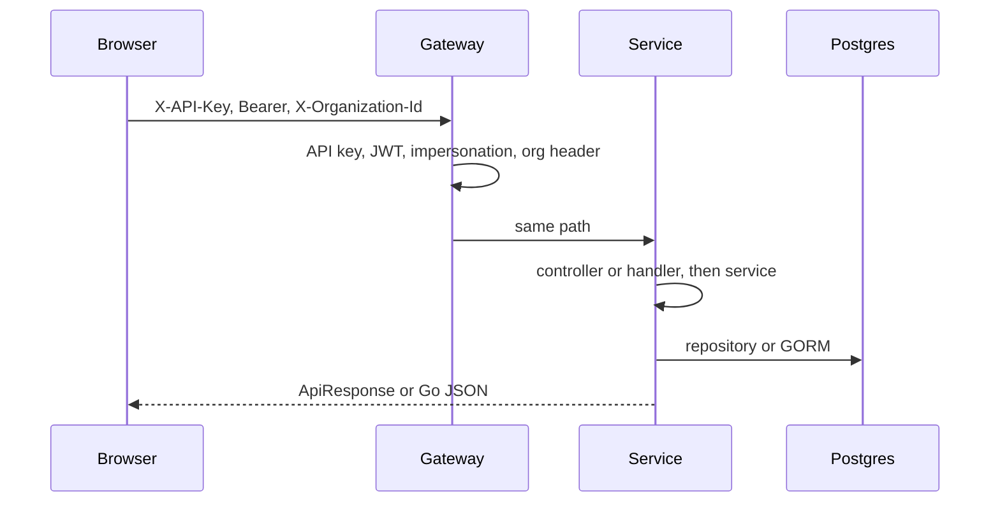
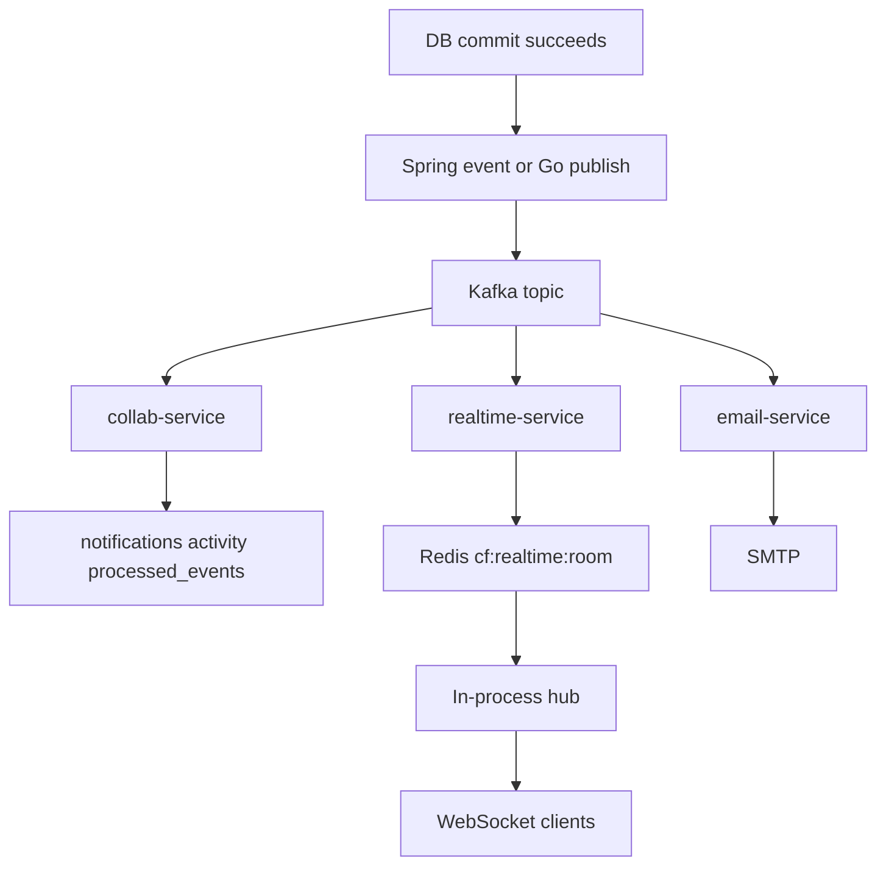

# 05 — Layer connections

**Goal:** Follow one HTTP call and one Kafka event across process boundaries.

## Synchronous path

### 1. Browser

`frontend/lib/api/client.ts` builds the URL from `NEXT_PUBLIC_API_BASE_URL` (the gateway, not a service port). It sets `X-API-Key` from `NEXT_PUBLIC_API_KEY`. If `auth` is on, it sets `Authorization`. If `orgHeader` is on, it sets `X-Organization-Id` from the session. Domain files (`auth.ts`, `platform.ts`, `tasks.ts`, `collab.ts`, `admin.ts`, `documents.ts`) choose the path and those flags.

The session lives in `frontend/lib/auth/session` (imported by the client). Tokens are not stored in this documentation.

### 2. Gateway filters

Order is by Spring `Ordered` values plus the security chain. The pieces that matter:

| Filter or config | File | What it does |
|------------------|------|----------------|
| `ApiKeyGatewayFilter` | `api-gateway/.../filter/ApiKeyGatewayFilter.java` | Requires `X-API-Key` on `/api/**`. WebSocket may pass `apiKey` as a query parameter. |
| `GatewaySecurityConfig` | `.../config/GatewaySecurityConfig.java` | HS256 JWT decoder. Public paths listed in chapter 04. Failures use `GatewayJsonAuthEntryPoint` and `GatewayJsonAccessDeniedHandler`. |
| `ImpersonationGatewayFilter` | `.../filter/ImpersonationGatewayFilter.java` | If claim `actor` is set, `ImpersonationRules` blocks mutations. |
| `OrgHeaderGatewayFilter` | `.../filter/OrgHeaderGatewayFilter.java` | Forwards `X-Organization-Id` upstream. |
| `RequestIdGatewayFilter` | `.../filter/RequestIdGatewayFilter.java` | Correlation id on the way through. |
| Route map | `application.yml` | Picks the upstream URI. |

The gateway does not load org roles and does not read `is_master_admin`.

### 3. Java service

Typical stack:

1. `ApiKeyFilter` (`common`) if the call hit the service directly as well as through the gateway.
2. `JwtAuthenticationFilter` in that service. `JwtService.userId` reads the subject. The principal is a `UUID`.
3. Controller method with `@ApiId` and `@CurrentUserId`. Task methods also use `@CurrentOrganizationId`.
4. `ApiIdMdcInterceptor` puts `apiId` and `userId` on the SLF4J MDC so log lines can be tied to the handler.
5. `service/impl` checks permissions or master-admin, writes JPA repositories, and publishes an in-process Spring event.
6. After the transaction commits, a `*KafkaPublisher` sends `DomainEvent` JSON.

Exceptions become `ErrorResponse` in `GlobalExceptionHandler` (`BusinessException`, `ForbiddenException`, `ConflictException`, `UnauthorizedException`, `ResourceNotFoundException`).

### 4. Go service

`cmd/server/main.go` registers Gin routes. Protected groups use `middleware.JWTAuth` (collab) or `auth.ParseUserID` (realtime and document). The secret is `JWT_SECRET`, algorithm HS256, subject is the user UUID. Handlers stay thin. `internal/service` holds the rules. Repositories use GORM.

Collab’s `platform.Client` is the exception that calls another service: `POST` member endpoints on platform with `X-API-Key` and the caller’s `Authorization` header.

## Kafka path

| Step | Who | Detail |
|------|-----|--------|
| Produce | Java `TaskKafkaPublisher`, auth and user email publishers, platform publishers, collab `kafka.Producer` | JSON `DomainEvent`, key often the entity id |
| Consume task assign | collab `NewTaskAssignedConsumer` | `FanOutAssigned` runs notification and activity handlers |
| Consume task create, comments, platform topics, task delete, and status | collab `NewJSONConsumer` plus the older readers | Activity rows. `task.status_changed` also notifies the assignee when they are not the actor. |
| Consume `task.updated`, `task.status_changed`, `task.deleted`, and `comment.added` | realtime `internal/kafka/consumer.go` | `redisx.Bus.Publish` |
| Fan-out | realtime hub | `PSUBSCRIBE cf:realtime:*` then `hub.BroadcastLocal` |
| Mail | email-service | `smtp.Send` plain text |

Platform org, workspace, and project topics are read by collab and written to `activity_feed`. They are not broadcast on the WebSocket. `user.created` and `user.updated` stay without a consumer.

## Who calls whom

| From | To | Why |
|------|----|-----|
| Browser | Gateway only | [docs/fe-contract.md](../fe-contract.md) |
| Gateway | All HTTP services except email | Route table |
| collab | platform HTTP | Invitation accept adds members |
| Java services | Kafka | After commit |
| collab | Kafka | `comment.added`, invitation `email.send` |
| realtime | Redis and Postgres (read) | Broadcast and ACL |
| email | SMTP | MailHog on port 1025 locally |
| document, realtime | Postgres | Membership reads. They do not call platform HTTP. |

There is no service mesh and no synchronous Java-to-Java call for the task and org flows opened here. user-service can call auth to revoke sessions (`AuthSessionRevoker` uses `collabflow.auth.base-url` / `AUTH_SERVICE_URI`). That is an HTTP call for session revoke, not for profile data. Profile data is the shared `users` table.

## A concrete example

Assign a task:

1. Browser `PUT /api/v1/tasks/{id}/assign` with API key, bearer token, and org header.
2. Gateway route `task-service` → port 8083.
3. `TaskController` method `TASK-007` checks org membership.
4. `TaskServiceImpl` updates `tasks.assignee_id` and publishes `TaskAssignedDomainEvent` and `TaskUpdatedDomainEvent`.
5. HTTP response returns.
6. After commit, `TaskKafkaPublisher` sends `task.assigned` and `task.updated`.
7. collab writes a notification (and an activity row) and may log a stub email.
8. realtime publishes to `project:{projectId}` and `task:{taskId}`.
9. Browsers that subscribed to those rooms receive `{ type, room, data }`.

## Glossary

| Term | Meaning |
|------|---------|
| MDC | Mapped diagnostic context. Log fields `apiId` and `userId` for one request. |
| Upstream | The service the gateway proxies to. |
| Fan-out | One event delivered to many sockets or to more than one handler. |

## Unverified

The exact header name `RequestIdGatewayFilter` writes was not re-read in this pass. The class exists and is registered. Use the filter source if you need the header string. `OrgHeaderGatewayFilter` was confirmed by name and by the gateway survey; the task controller is what actually requires the header.
