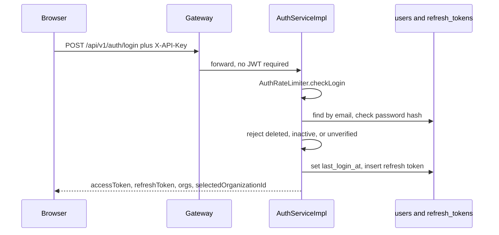

# 06 — Flow: authentication

**Goal:** Follow register, login, refresh, email verification, and organization select from the browser to `users` and back.

## What this flow is for

A person proves who they are and receives an access token plus a refresh token. The access token’s subject is the user id. It does not carry the organization id or the org role. The client stores the selected organization and sends `X-Organization-Id` on later calls (`frontend/lib/api/client.ts`, `JwtService.sign`).

## Pieces

| Piece | File |
|-------|------|
| HTTP | `auth-service` `AuthController` |
| Rules | `AuthServiceImpl` |
| Tokens | `JwtService` (HS256, jjwt) |
| Refresh rows | `RefreshToken` / `RefreshTokenRepository` |
| Seed | `MasterAdminSeeder` |
| Rate limit | `AuthRateLimiter` |
| Mail event | `EmailSendKafkaPublisher` after commit |
| Gateway | Public paths in `GatewaySecurityConfig` |
| Client | `frontend/lib/api/auth.ts` and `client.ts` |

## Login

`AuthServiceImpl.login` (confirmed):

1. Normalize email to lower case.
2. Unknown email or bad password → `UnauthorizedException` “Invalid email or password”. The log line on a bad password does not include the password.
3. `deleted_at` set → “This account has been deleted”.
4. `is_active` false → “This account has been deactivated”.
5. Email not verified, and the user is not a master admin → `BusinessException` FORBIDDEN “Email not verified…”.
6. Save `last_login_at`.
7. `issueTokensWithOrgContext` with `requireOrgMembership = true`.

Org context inside `issueTokensWithOrgContext`:

| Situation | Result |
|-----------|--------|
| Requested org id, and the user is a member (or is master admin) | `selectedOrganizationId` is that id |
| Requested org id, user is not a member and not master admin | FORBIDDEN |
| No org requested, exactly one membership | That org is selected |
| No org requested, more than one membership | `requiresSelection = true`, selected id null |
| No memberships, and membership is required, and user is not master admin | FORBIDDEN “No organization membership…” |
| Master admin with no memberships | Tokens still issued |

The access token is `JwtService.createAccessToken`: subject = user id, claim `email`, expiry from `JWT_ACCESS_MINUTES`. The refresh token is two random UUIDs joined by a dot, stored in `refresh_tokens`, expiry `JWT_REFRESH_DAYS`. It is not a JWT.

The frontend then calls org select when `requiresSelection` is true (`AUTH-016`), stores `accessToken`, `refreshToken`, and `organizationId`, and sends the org header after that ([docs/fe-contract.md](../fe-contract.md)).

## Register

`POST /api/v1/auth/register` (`AUTH-002`). `AuthServiceImpl.register` returns immediately with FORBIDDEN if `authProperties.isPublicRegisterEnabled()` is false (`AUTH_PUBLIC_REGISTER_ENABLED`). The default in `AuthPhase2Properties` is false. The intended path is admin create (chapter 12), not open signup.

When register is enabled, `createUser` inserts `users`, `issueVerifyEmail` publishes `email.send` with template `verify_email` after commit, and tokens are issued with `requireOrgMembership = false` so a new user can exist before they belong to an org.

## Refresh and logout

`POST /api/v1/auth/refresh` (`AUTH-004`). `AuthServiceImpl.refresh` loads `refresh_tokens` where the token matches and `is_revoked` is false. Expired → unauthorized. Otherwise the old row is revoked (`is_revoked`, `revoked_at`) and a new pair is issued. Membership is not required on refresh (`requireOrgMembership = false`). Deleted or inactive users are rejected.

`POST /api/v1/auth/logout` revokes the presented refresh token if it is still active. It does not require a bearer token at the gateway (`permitAll`).

`frontend/lib/api/client.ts` retries a failed call once by posting the stored refresh token. It does not send the bearer token on that refresh call.

## Email verify and password reset

| Step | Method | What happens |
|------|--------|----------------|
| Verify | AUTH-008 | Consumes an `email_tokens` row with purpose `VERIFY_EMAIL` |
| Resend | AUTH-009 | Rate limit `resend_verify`, new token, `email.send` |
| Forgot | AUTH-010 | Rate limit `forgot_password`, purpose `RESET_PASSWORD` |
| Reset | AUTH-011 | Consumes the token and sets a new password hash |
| Change while signed in | AUTH-012 | JWT required |

`issueVerifyEmail` builds a link with `PUBLIC_APP_BASE_URL` and the token, template name `verify_email`. The message is plain text in the Kafka payload. email-service sends that body as `text/plain` when `EMAIL_SERVICE_ENABLED=true`. MailHog UI is port 8025 ([docs/running.md](../running.md)).

## Select organization

`GET /api/v1/auth/organizations` (`AUTH-017`) lists memberships via `organizationMemberRefRepository` and active orgs. Each summary has id, name, slug, and role id (`OrganizationSummary`).

`POST /api/v1/auth/select-organization` (`AUTH-016`) calls `issueTokensWithOrgContext` again with the requested id and `requireOrgMembership = true`. The new access token still has only `sub` and `email`. The new response carries `selectedOrganizationId`. The client must keep sending that id in the header. Selecting an org also rotates the refresh token, because every call to `issueTokensWithOrgContext` inserts a new refresh row.

## Master admin seed

`MasterAdminSeeder` implements `ApplicationRunner`. On auth startup it reads `MASTER_ADMIN_EMAIL`, `MASTER_ADMIN_PASSWORD`, and `MASTER_ADMIN_NAME`. If that email exists, it ensures `is_master_admin`, verified, and active. If not, it inserts a user with the password encoded and the flag set. Do not put those values in docs or logs.

A master admin can log in even when `is_email_verified` is false, and can receive tokens with zero org memberships.

## Rate limit

Before login, register, refresh, resend, and forgot-password, `AuthRateLimiter` increments `rate_limit:auth:{action}:{clientKey}` in Redis. Over the limit → FORBIDDEN. Redis down → allow in `dev` / `local` / no profile; reject otherwise.

## Glossary

| Term | Meaning |
|------|---------|
| Access token | Short-lived JWT. `sub` is the user UUID. |
| Refresh token | Opaque string in `refresh_tokens`, rotated on use. |
| requiresSelection | Response flag when the user belongs to more than one org and did not pick one. |

## Unverified

The exact client-key string passed into `checkLogin` (IP versus email) was not opened in the controller. The Redis key shape and the fail-open rule were read in `AuthRateLimiter`. Verify-email’s token lookup method was not re-read line by line; the table `email_tokens` and the publisher payload were.
