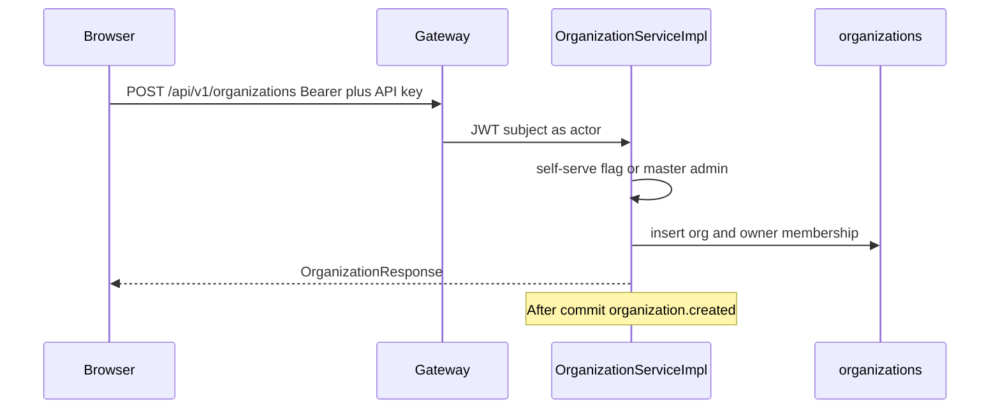
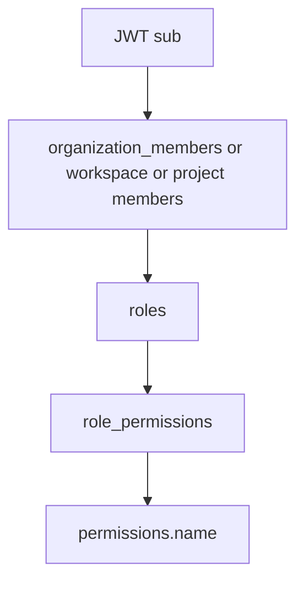

# 07 — Flow: tenancy

**Goal:** See how an organization, workspace, and project are created and how membership and roles are stored.

## What this flow is for

Tenancy is the hierarchy Organization → Workspace → Project. platform-service owns the tables and the HTTP API. task-service does not create projects. collab-service does not insert member rows.

A signed-in user is identified by the JWT subject. Whether they may create or edit is decided by `PermissionService` (role → `role_permissions` → `permissions.name`) except for organization create, which has an extra gate.

## Pieces

| Piece | Class or file |
|-------|----------------|
| Org HTTP | `OrganizationController` |
| Workspace HTTP | `WorkspaceController` |
| Project HTTP | `ProjectController` |
| Roles | `RoleController` `GET /api/v1/roles` |
| Org rules | `OrganizationServiceImpl` |
| Events | `OrganizationKafkaPublisher`, `WorkspaceKafkaPublisher`, `ProjectKafkaPublisher` |
| Flag | `collabflow.platform.self-serve-org-create` in `platform-service` `application.yml`, default false, env `PLATFORM_SELF_SERVE_ORG_CREATE` |
| Client | `frontend/lib/api/platform.ts` |

## Create an organization

Two doors:

| Door | ApiId | Who |
|------|-------|-----|
| Product | ORG-001 `POST /api/v1/organizations` | `create` → `requireSelfServeOrMasterAdmin` |
| Admin | ADMIN-ORG-001 `POST /api/v1/admin/organizations` | `createAsAdmin` → `requireMasterAdmin`, owner id in the body |

`requireSelfServeOrMasterAdmin` (`OrganizationServiceImpl`): if self-serve is true, any authenticated caller may continue; if false, the caller must have `users.is_master_admin` (`UserRefRepository.existsByIdAndActiveTrueAndMasterAdminTrue`). The default is false, so a normal member cannot create an org unless you turn the flag on.

`createInternal` writes `organizations` (name, slug, owner) and the owner’s `organization_members` row. Admin create also writes `admin_audit_events` action `ORG_CREATED`. After commit, `organization.created` is published. Nothing in this repo consumes that topic.

Slug is unique. Plan defaults are in the table definition (`FREE` and member caps). See chapter 03.

## Workspaces

`WS-001` `POST /api/v1/workspaces` creates a workspace under an organization the caller can manage. The row stores `organization_id`, `owner_id`, and a unique `invite_code`. `WS-002` lists workspaces for an org id in the path: `GET /api/v1/organizations/{orgId}/workspaces`.

`WS-010` `POST /api/v1/workspaces/{id}/join` joins with the invite code.

Member routes `WS-006` through `WS-009` list, add, change role, and remove. Adding a member is also what invitation accept calls (`platform.Client.AddWorkspaceMember`).

Workspace events: `workspace.created`, `.updated`, `.deleted`, `.member_added`, `.member_removed`. Collab writes an activity row for each (`WORKSPACE_*`, or `MEMBER_JOINED` / `MEMBER_LEFT`).

`X-Organization-Id` is not required on every platform route. Task-service is stricter. Platform scopes most calls by the id in the path and by `PermissionService`. `OrganizationController.get` (ORG-003) can take `@CurrentOrganizationId` and check membership when the header is present. The platform README note that says the header is still a TODO is only partly true: the helper exists, and it is not applied to every mutating route.

## Projects

`PRJ-001` `POST /api/v1/projects` creates a project under a workspace. Optional `parent_project_id` nests projects. `workflow_id` may be set; the column has no foreign key (chapter 03).

`PRJ-002` lists projects in a workspace. Member routes are `PRJ-006` through `PRJ-009`.

Project events use the same five suffixes on `project.*`. Payloads include `organizationId`. Collab writes the matching activity row.

## Roles

`ROLE-001` `GET /api/v1/roles?scope=` returns system roles for `ORGANIZATION`, `WORKSPACE`, or `PROJECT`. Seeds are inserted by platform Flyway V1 (org), V3 (workspace), and V4 (project). Task Flyway adds permission rows such as `task.*` and `sprint.*` into the same `permissions` table. It does not create a new role table.

When you add a member you send a `roleId` whose `scope` matches the level. The member row stores that id. It does not store a copy of the permission list.

## How a member is allowed to continue

Master admin bypasses the self-serve gate and the admin controllers. It does not automatically grant every `task.update`. Task handlers still call `requireMembership` for the org header. A master admin with no `organization_members` row will fail that check. Admin provisioning attaches the member first (chapter 12).

## Events that write activity

Org, workspace, and project created, updated, deleted, and member events are consumed by collab after commit. The activity row uses the caller as `actorId` (owner-create uses the owner). Delete activity says the org or workspace was deactivated, or the project was archived. These topics do not send email and do not create a notification. `ORGANIZATION_INVITE` is still an invitation, not a member row.

## Glossary

| Term | Meaning |
|------|---------|
| Self-serve | Flag that lets any signed-in user create an organization. Default off. |
| Owner | `organizations.owner_id` and the Owner role. Not the same as master admin. |
| Invite code | `workspaces.invite_code`, used by WS-010. Separate from email invitations in collab. |

## Unverified

The exact permission name strings `PermissionService` checks on workspace create were not opened method by method. The gate on org create and the route list were. Read `WorkspaceServiceImpl` and `ProjectServiceImpl` before changing a permission check.
