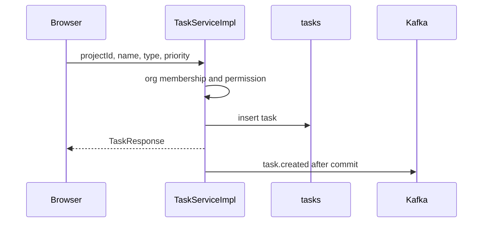

# 08 — Flow: tasks

**Goal:** Follow create, update, status change, assign, sub-tasks, and sprints, including which Kafka topics fire.

## What this flow is for

task-service is the only writer of `tasks`, `sprints`, and workflow tables. A task always points at a project, a workspace, and an organization. Those parent rows were created in platform-service. The task row copies the ids so lists do not have to join for every query.

## Pieces

| Piece | Class |
|-------|--------|
| HTTP | `TaskController`, `SprintController`, `WorkflowController`, `TaskTypeController` |
| Rules | `TaskServiceImpl`, `SprintServiceImpl` |
| Org check | `OrganizationContextService.requireMembership` |
| Permissions | `PermissionService` |
| Events | `TaskKafkaPublisher` after commit |

Every handler on `TaskController` takes `@CurrentUserId` and `@CurrentOrganizationId` and calls `requireOrg`, which calls `requireMembership`. Missing or foreign org header fails before the task is read. The gateway already required a JWT.

## Create

`POST /api/v1/tasks` (`TASK-001`).

`TaskServiceImpl.create` publishes `TaskCreatedDomainEvent` with a `TaskCreatedPayload` (the publisher sends topic `task.created`). collab’s `NewTaskCreatedConsumer` turns that into an `activity_feed` row. realtime does **not** listen to `task.created`. A board that only listens for `task.updated` will not move until a later update, unless the UI reloads from HTTP.

## List and stats

`GET /api/v1/tasks?projectId=` (`TASK-002`) filters by `statusId`, `assigneeId`, `priority`, `sprintId`. Page and size default to 0 and 20 in `TaskController.list`. The body is `ApiResponse` of `PageResponse`.

`GET /api/v1/tasks/stats?projectId=` (`TASK-008`) returns counts for the project. This route is declared before `/{id}` in the controller so the word `stats` is not parsed as a UUID.

## Update, delete, sub-tasks

| Action | ApiId | Event after commit |
|--------|-------|--------------------|
| PUT task | TASK-004 | `task.updated` |
| DELETE task | TASK-005 | `task.deleted` (collab activity from the payload, and a realtime frame on `project:{id}`) |
| GET sub-tasks | TASK-009 | none |
| POST sub-task | TASK-010 | `task.created` |

`TaskServiceImpl.createSubtask` builds a `CreateTaskRequest` with `parentTaskId` and calls `create`. The child is a normal task row plus `task.created`.

The task list opens New task and Edit task in a dialog. The task detail page uses the same edit dialog. Both send an optional due date as a local calendar day. `TaskServiceImpl.update` writes `due_date` from the body, so a null `dueDate` clears it. A PUT that leaves the field out also clears it, because a missing instant is null.

## Status

`PUT /api/v1/tasks/{id}/status` (`TASK-006`). `TaskServiceImpl.changeStatus` requires permission `TASK_MOVE`, loads the project workflow, and rejects the change unless `workflow_transitions` contains that from/to pair. The column `require_comment` exists on the table. This method does not read it. Moving to a status whose category is `DONE` sets `closed_at`; any other category clears it. The task detail shows that timestamp as Completed. On success it publishes **two** events:

1. `TaskStatusChangedDomainEvent` → topic `task.status_changed`. Collab writes activity `TASK_UPDATED` with a status change JSON, and notifies the assignee when they are not the actor. Realtime broadcasts `task.status_changed` on `project:{id}` and `task:{id}`.
2. `TaskUpdatedDomainEvent` → topic `task.updated` (realtime, so existing board clients still move).

The second event is what makes a WebSocket board update. `TaskUpdatedData` on the realtime side reads `taskId`, `projectId`, and `name`.

## Assign

`PUT /api/v1/tasks/{id}/assign` (`TASK-007`). `TaskServiceImpl.assign` requires permission `TASK_ASSIGN`. If the new assignee is not null, they must already be a project member. The method publishes:

1. `TaskAssignedDomainEvent` → `task.assigned`. collab `FanOutAssigned` writes a notification (`TASK_ASSIGNED`) and an activity row. `NotificationService` also calls `email.StubSend` in process. That does not go to email-service.
2. `TaskUpdatedDomainEvent` → `task.updated` for the live board.

Assignee is `tasks.assignee_id` → `users.id`.

## Sprints

`SprintController` uses the same org membership check.

| ApiId | Action | Kafka |
|-------|--------|-------|
| SPRINT-001–005 | Create, list, get, update, delete | No task topic on sprint row changes (not seen in `SprintServiceImpl` event publishes) |
| SPRINT-006 | Start | Sprint status `ACTIVE` |
| SPRINT-007 | Complete | Sprint status `COMPLETED` |
| SPRINT-008 | Attach a task | `TaskUpdatedDomainEvent` |
| SPRINT-009 | Detach a task | `TaskUpdatedDomainEvent` |

`tasks.sprint_id` is the foreign key from task Flyway V2. Only the attach and detach paths were seen publishing `task.updated` in `SprintServiceImpl`.

## Workflows the board needs first

Before a task exists, a default workflow must exist. Task Flyway V1 seeds a default workflow, statuses, and transitions. The UI reads:

- `GET /api/v1/workflows/default` (WF-001)
- `GET /api/v1/workflows/{id}/statuses` (WF-003)
- `GET /api/v1/task-types` (WF-004)

Those three do not take the org header in the controller survey. They still require a JWT at the gateway.

## What the UI should expect

| User action | HTTP returns | Live clients see |
|-------------|--------------|------------------|
| Create | The new task | Activity feed later. Not a `task.updated` socket event. |
| Edit fields | Updated task | `task.updated` on `project:{id}` and `task:{id}` |
| Change status | Updated task | `task.updated` and `task.status_changed` on `project:{id}` and `task:{id}`. Activity row. Notification if the assignee is someone else. |
| Assign | Updated task | Notification for the assignee, activity, and `task.updated` |
| Delete | Success | `TASK_DELETED` activity from the payload (the row is already gone) and a `task.deleted` frame on `project:{id}` |

Start collab and realtime before you assign, or assign again. Consumers use `LastOffset`.

## Glossary

| Term | Meaning |
|------|---------|
| Transition | Allowed pair of statuses in `workflow_transitions`. |
| Dual publish | One user action emits both a specific topic and `task.updated`. |
| Position | `tasks.position` for ordering inside a status column. |

## Unverified

Sprint start and complete were not opened for Kafka publishes. Only attach and detach showed `TaskUpdatedDomainEvent` in `SprintServiceImpl`.
