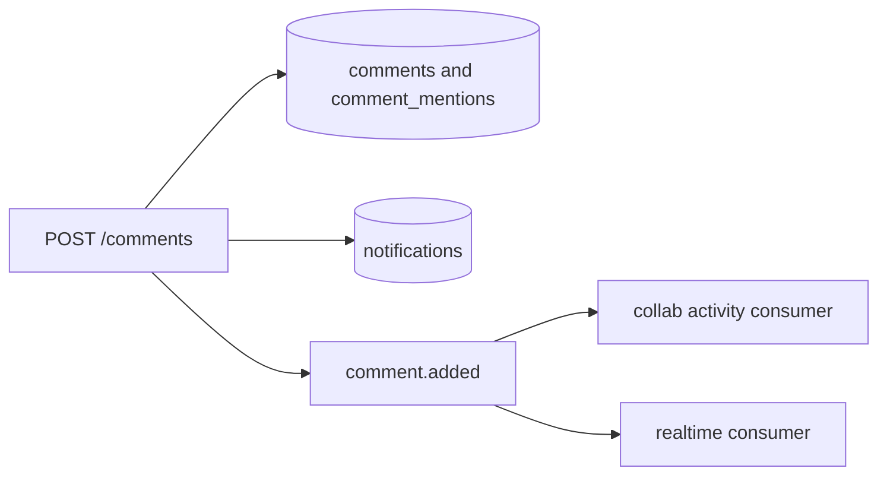
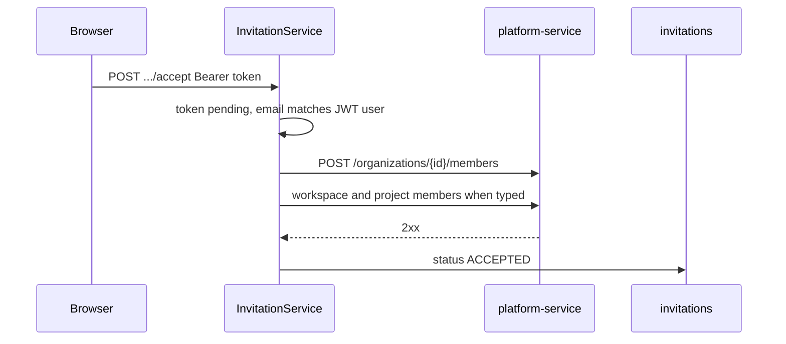

# 09 — Flow: collaboration

**Goal:** Follow comments, mentions, activity, notifications, and invitation accept.

## What this flow is for

collab-service is the Go process for side effects and for the collaboration HTTP API. It writes its own tables. When an invite is accepted it asks platform-service to write member rows. It does not insert into `organization_members` itself (`InvitationService.Accept` comment in code).

## Pieces

| Piece | Where |
|-------|--------|
| Wiring | `collab-service/cmd/server/main.go` |
| Comments | `CommentService`, `CommentHandler` |
| Notifications | `NotificationService` |
| Activity | `ActivityService` |
| Invites | `InvitationService`, `platform.Client` |
| Idempotency | `processed_events` |
| Client | `frontend/lib/api/collab.ts` |

JWT middleware wraps every route except `GET /collab/health` and `GET /invitations/token/:token`.

## Comments and mentions

`POST /api/v1/comments` (`CMT-001`). `CommentService.Create`:

1. Saves the comment and mention rows in one repository call (`CreateWithMentions`).
2. Parses `@` followed by a UUID (`mentionPattern`). That is the mention syntax, not a display name.
3. For each mentioned user other than the author, inserts a notification in process with `notification_type` `COMMENT_MENTION`.
4. Publishes Kafka `comment.added` with `commentId`, `entityType`, `entityId`, `authorId`.

Update and delete (`CMT-004`, `CMT-005`) require the caller to be the author.

`comment.added` consumers:

| Consumer | Effect |
|----------|--------|
| collab `NewCommentAddedConsumer` | Activity row. Idempotency key `eventId + ":activity"`. |
| realtime `NewCommentAddedConsumer` | Redis room `project:{id}` if entity type is `PROJECT`, otherwise `task:{id}` (`roomForEntity`). |

The mention notification does not wait for Kafka. If Kafka publish fails, the comment and the mention notification can already be saved. Activity and the WebSocket message can be missing.

## Notifications inbox

| ApiId | Call | Behavior |
|-------|------|----------|
| NOTIF-001 | `GET /api/v1/notifications` | Page of rows for the JWT user. Optional `X-Organization-Id`. |
| NOTIF-004 | `GET /api/v1/notifications/unread-count` | Count |
| NOTIF-002 | `PUT /api/v1/notifications/{id}/read` | One row |
| NOTIF-003 | `PUT /api/v1/notifications/read-all` | All, optional org filter |

Rows are also created by the `task.assigned` consumer (`NotificationService.HandleTaskAssigned`), not only by comments. That handler calls `email.StubSend` with the user’s email. It does not publish `email.send`. With or without `EMAIL_SERVICE_ENABLED`, assignment mail stays a log line inside collab.

## Activity

`ActivityService` handles `task.created`, `task.assigned`, `comment.added`, and the scoped topics started from `main.go`: organization, workspace, and project created/updated/deleted and member added/removed, plus `task.deleted` and `task.status_changed`. One `NewJSONConsumer` per topic calls `HandleScoped`. The action map is `activitySpec`. A missing `actorId` is marked processed and skipped so a bad message does not retry forever. `task.deleted` does not load `tasks`. Soft deletes record metadata `effect` `deactivated` (org, workspace) or `archived` (project).

`task.status_changed` also calls `NotificationService.HandleStatusChanged`. The idempotency key is `eventId + ":notification"`. The handler loads the task only to read `assignee_id`. If there is no assignee, or the assignee is the actor, it marks that key processed and does not insert a row. It does not call `email.StubSend`.

List routes:

| ApiId | Path |
|-------|------|
| ACT-001 | `GET /api/v1/activity?organizationId=` |
| ACT-002 | `GET /api/v1/activity?entityType=&entityId=` |
| ACT-003 | `GET /api/v1/activity/entity/{type}/{id}` |
| ACT-004 | `GET /api/v1/activity/user/{id}` |

`processed_events` stops a replay of the same `eventId` from inserting a second notification. Activity uses a different id so both handlers can run for one `task.assigned` message (`FanOutAssigned` in `main.go`).

## Invitations

Create: `POST /api/v1/invitations` (`INV-001`). `InvitationService.Create` stores `invitations` (`PENDING`, token, email, org, optional workspace and project, type `ORGANIZATION`, `WORKSPACE`, or `PROJECT`). `publishInvitationEmail` sends `email.send` with template `invitation` and a link `{APP_PUBLIC_URL}/invite/{token}`.

Peek: `GET /api/v1/invitations/token/{token}` (`INV-002`) has no JWT. The gateway allows it. The handler returns the invite so a landing page can render it.

Accept:

`applyPlatformMembership` always calls `AddOrgMember` with role constant `RoleOrgMember`. Workspace invites also call `AddWorkspaceMember`. Project invites also call `AddProjectMember`. Headers: `X-API-Key` from collab’s `API_KEY`, and `Authorization` forwarded from the accept request (`platform/client.go`). If platform fails, the invite stays pending (`ErrInvitePlatform`).

Decline: `DELETE /api/v1/invitations/{id}` sets status `DECLINED`. The invitee can do that when the JWT email matches. A caller with `manage_members` for that invite can do it too. That is the org page Cancel button. Anyone else gets 403.

List mine (`INV-003`) is an inbox: pending rows for the JWT email, with no organization filter. List by org (`INV-004`) needs `X-Organization-Id` or `?organizationId=` and `organization.manage_members`. Create (`INV-001`) requires the matching `manage_members` permission: organization, workspace, or project. Workspace and project checks also require the row to belong to that organization.

## Email switch

`main.go`: if `EMAIL_SERVICE_ENABLED` is true, collab does not start `NewEmailSendConsumer`. email-service must be running or invitation mail stays on the topic. If the flag is false, collab’s `EmailService.HandleEmailSend` logs the message and records `processed_events`. It does not open an SMTP connection.

`CommentService.Create` accepts `entityType` `TASK` or `PROJECT` only. The catalog also lists `DOCUMENT`. Other types are rejected before insert. The mention notification’s `organization_id` comes from `OrganizationIDForEntity` on the comment repository (the entity’s organization, not the request header).

## Glossary

| Term | Meaning |
|------|---------|
| Mention | `@` plus the user’s UUID inside comment text. |
| Peek | Public read of an invite by token. |
| Forwarded bearer | The accept call’s JWT, sent again to platform so platform sees the same user. |

## Unverified

The SQL inside `OrganizationIDForEntity` was not opened. The call site shows it runs before the comment is saved and supplies `organization_id` on the mention notification.
