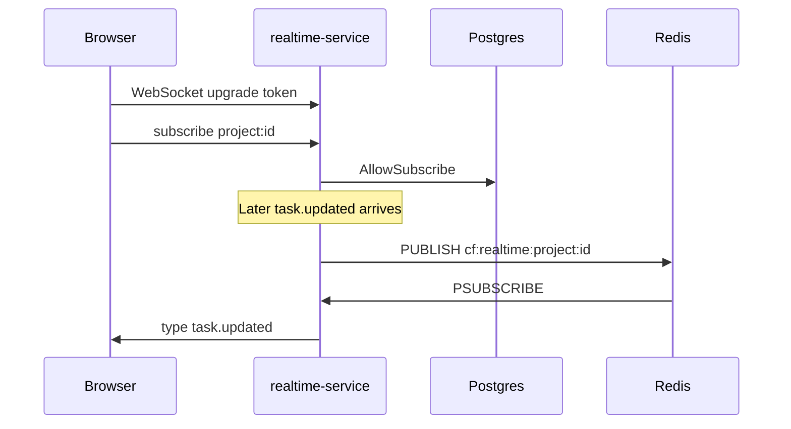

# 10 — Flow: realtime

**Goal:** See how a task update becomes a WebSocket message on the right room.

## What this flow is for

realtime-service does not own business tables. It checks membership in the shared database, consumes two Kafka topics, and fans messages out through Redis so more than one process could serve sockets.

## Pieces

| Piece | File |
|-------|------|
| Process | `realtime-service/cmd/server/main.go` |
| Socket | `internal/handler/ws.go` `WSHandler` |
| ACL | `internal/acl/membership.go` `Checker` |
| Kafka | `internal/kafka/consumer.go` |
| Redis | `internal/redisx/pubsub.go` prefix `cf:realtime:` |
| Hub | `internal/hub/hub.go` |
| Client | Browser after `ws://localhost:8080/api/v1/realtime/ws` |

## Connect

`GET /api/v1/realtime/ws` (`RT-001`).

The gateway permits this path without a JWT and accepts the API key as `?apiKey=`. The handler accepts the user token as `Authorization: Bearer` or `?token=`. Optional org id: header `X-Organization-Id` or `?organizationId=`. If that id is set, `Checker.IsOrgMember` must be true or the handshake fails.

Outbound messages look like `{ type, room, data }` (`hub.OutMessage`).

## Subscribe

Client text frame:

`{"action":"subscribe","room":"project:<uuid>"}`

Also `unsubscribe` and `ping`. Room kinds in `AllowSubscribe`:

| Room | Allowed when |
|------|----------------|
| `org:{uuid}` | Row in `organization_members`. If the handshake org id is set, it must equal the room id. |
| `project:{uuid}` | Row in `project_members`, or else any org member of that project’s organization (`canAccessProject`). Optional org id must own the project (`projects` join `workspaces`). |
| `task:{uuid}` | Load `tasks.project_id` and `organization_id`. Same project rule. Optional org id must match the task’s org. |
| `user:{uuid}` | Only when the uuid is the JWT subject. |

Unknown prefixes and bad UUIDs are rejected.

## From Kafka to the socket

`main.go` starts four consumers, group `realtime-service` unless `KAFKA_GROUP_ID` is set, `StartOffset` last. Platform topics are not broadcast.

| Topic | Rooms | Payload fields copied |
|-------|-------|------------------------|
| `task.updated` | `project:{projectId}` and `task:{taskId}` | `taskId`, `projectId`, `name`, `eventId` |
| `task.status_changed` | `project:{projectId}` and `task:{taskId}` | `taskId`, `projectId`, `fromStatusId`, `toStatusId`, `name`, `eventId` |
| `task.deleted` | `project:{projectId}` | `taskId`, `projectId`, `name`, `eventId` |
| `comment.added` | `project:{entityId}` if type is `PROJECT`, else `task:{entityId}` | `commentId`, `entityType`, `entityId`, `authorId`, `eventId` |

`Bus.Publish` writes channel `cf:realtime:` plus the room. `SubscribeAll` pattern-subscribes `cf:realtime:*` and calls `hub.BroadcastLocal`. Clients subscribed to that room get the frame. A second realtime process would receive the same Redis message and write to its own clients. Kafka would still be read by only one member of the consumer group.

`task.assigned` and `task.created` are not consumed here. The board moves when task-service also publishes `task.updated` (status, assign, field update, sprint attach). A brand-new task does not emit `task.updated` from `TaskServiceImpl.create`.

## Manual broadcast

`POST /api/v1/realtime/broadcast` (`RT-002`) publishes to Redis without Kafka. `config.BroadcastAllowed()` is true when `GIN_MODE` is `debug` or unset, or `APP_ENV` is `dev`. It is a development hook. It still requires a JWT.

## Impersonation

`ImpersonationRules` refuses WebSocket upgrade and the path `/api/v1/realtime/ws` when the JWT contains `actor`. A read-only impersonation session cannot open a socket. The filter reads `Authorization`, not `?token=`. A handshake that puts the impersonation token only in the query string is not covered by that filter. Prefer the header if you need the block. This limit is visible in `ImpersonationGatewayFilter`, which returns early when there is no `Bearer` header.

## Glossary

| Term | Meaning |
|------|---------|
| Room | A string `type:uuid` the client subscribes to. |
| Hub | In-memory map of connections on one process. |
| Pub/sub | Redis delivers one publish to every subscriber, including the publisher’s own process. |

## Unverified

The exact JSON error returned when `AllowSubscribe` fails was not copied from `ws.go`. The allow rules were read in `membership.go`. Ping and unsubscribe behavior was named in the handler survey, not re-read frame by frame.
