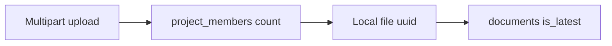

# 11 — Flow: documents

**Goal:** Follow upload, list, and download, and see where this differs from the older docs.

## What this flow is for

document-service stores file bytes on disk and a row in `documents`. It does not use Kafka, Redis, or MinIO. `backend/go-services/README.md` still says “stubs + MinIO”. `document-service/internal/config` uses `DOCUMENT_STORAGE_DIR` (default `data/documents`). Trust the config.

[docs/fe-contract.md](../fe-contract.md) tells the UAT UI not to rely on `/api/v1/documents/**`, and it says the service has no JWT or ACL. The handler that is in the tree now does both. The product warning can still stand while the code has moved. This chapter describes the code.

[docs/database.md](../database.md) lists `documents` as design-only. `database.Connect` runs `AutoMigrate` for `model.Document`. After the service has started once, the table exists.

## Pieces

| Piece | File |
|-------|------|
| Routes | `document-service/cmd/server/main.go` |
| Rules | `internal/handler/document.go` `DocumentHandler` |
| Row | `internal/model/document.go` |
| Disk | `internal/storage` `Save` |
| Gateway | Route `document-service` → `:9083` |
| Client | `frontend/lib/api/documents.ts` |

Health `GET /api/v1/documents/health` is public at the gateway. Upload, list, and content require a JWT. The service checks the bearer token itself (`auth.UserID`). It does not read `X-Organization-Id`. Access is `project_members` only.

## Upload

`POST /api/v1/documents/upload` (`DOC-001`), multipart.

| Form field | Required | Meaning |
|------------|----------|---------|
| `projectId` | Yes | Membership is checked against this id |
| `file` | Yes | Bytes |
| `name` | No | Defaults to the file name. Passed through `storage.SafeName`. |
| `entityType` | No | Default `PROJECT`. Allowed: `PROJECT`, `TASK`, `WORKSPACE`, `COMMENT`. |
| `entityId` | No | Defaults to `projectId` |

Steps in `DocumentHandler.Upload`:

1. Reject if there is no user id.
2. Reject if `project_members` has no row for `projectId` and that user. Org-member fallback is not used (unlike realtime).
3. Write the bytes to `{DOCUMENT_STORAGE_DIR}/{new uuid}`.
4. In a transaction, if a latest row exists with the same `entity_type`, `entity_id`, and `name`, set `is_latest` false and set the new row’s `version` to previous + 1 and `parent_document_id` to the old id.
5. Insert the new row with `is_latest` true, `file_path` equal to the uuid string, `uploaded_by` the JWT user.
6. Respond 201 `{ success, message, data }` with the DTO (id, name, type, size, version, project id, entity, uploader, created time).

There is no virus scan and no size limit in the handler section that was read. Do not treat that as a promise that the reverse proxy has no limit.

## List

`GET /api/v1/documents?projectId=` (`DOC-002`). Same membership check. Query is `entity_type = PROJECT`, `entity_id = projectId`, `is_latest = true`, newest first. Files stored with another entity type do not appear on this list.

Response data: `projectId`, `items`, `total`.

## Download

`GET /api/v1/documents/{id}/content` (`DOC-003`).

1. Load the row.
2. If `entity_type` is not `PROJECT`, respond 403 “Unsupported entity”.
3. Membership uses `entity_id` as the project id.
4. Stream the file at `filepath.Join(storageDir, filepath.Base(doc.FilePath))` so a stored path cannot climb out of the storage directory.

A task attachment can be uploaded (`entityType=TASK`) and then cannot be downloaded through this route until the handler allows that type. List will also hide it.

## What is not here

| Expected by older docs | In this service |
|------------------------|-----------------|
| MinIO | Not used |
| `document_folders`, permissions, tags | Not migrated |
| Kafka `document.uploaded` | Not produced |
| Gateway API key inside the Go process | Not checked. The gateway checks it when the call comes through port 8080. |

## Glossary

| Term | Meaning |
|------|---------|
| Latest | The current version of one file name on one entity. |
| Safe name | The storage helper’s check on the display name before it is stored. |
| Content route | The download URL. It is not the JSON metadata. |

## Unverified

`storage.SafeName` and `storage.Save` were not opened line by line. Upload calls them, and `FilePath` is set to the new id string in the handler. The on-disk layout `{dir}/{uuid}` comes from the handler plus the service survey of `storage.Save`. Open `internal/storage/files.go` before changing path rules.
