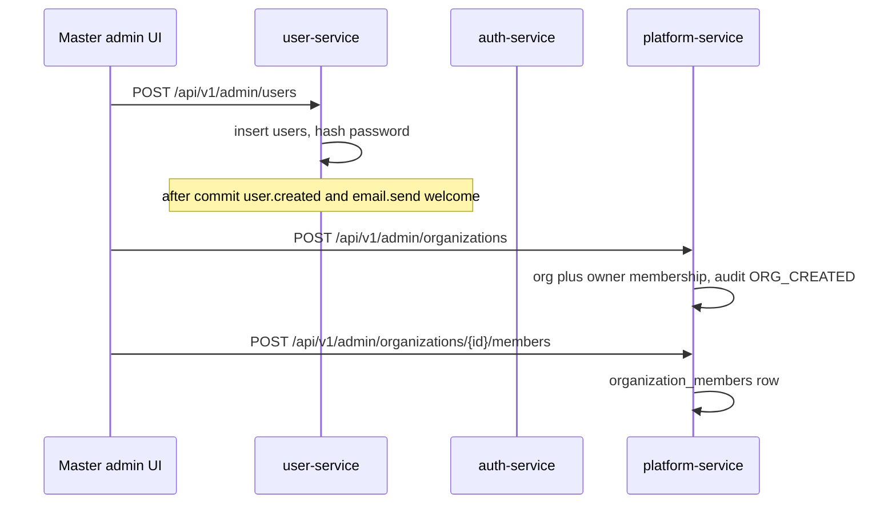

# 12 — Flow: admin

**Goal:** Follow master-admin provisioning: create a user, create an organization, attach a member, and the extra console features.

## What this flow is for

The product story in [docs/fe-contract.md](../fe-contract.md) is admin-provisioned. Public register is off by default. A master admin signs in, creates the user, creates the organization, and attaches the member. The member then verifies email, logs in, and picks the org.

Master admin is `users.is_master_admin`. It is not an organization role. The flag is seeded by `MasterAdminSeeder` in auth-service and can be changed with USER-023.

## Pieces

| Piece | Where |
|-------|--------|
| User directory | user-service `AdminUserController`, `UserServiceImpl` |
| Session lifecycle | auth-service `AdminSessionController` |
| Orgs | platform `OrganizationServiceImpl.createAsAdmin` |
| Console | platform `AdminConsoleService` |
| Audit | `admin_audit_events`. Writers in auth and user. Reader ADMIN-AUDIT-001. |
| UI | `frontend/lib/api/admin.ts`, routes under `frontend/app/(admin)/` |
| Gateway split | auth-admin route before user-service wildcard |

## Create user, org, and member

| Step | ApiId | Service | Rule |
|------|-------|---------|------|
| Create user | USER-020 | user-service | `requireMasterAdmin` |
| Create org with a chosen owner | ADMIN-ORG-001 | platform | Owner user must exist and be active |
| Attach member | ADMIN-ORG-002 | platform | Master admin. Body carries the user and role. |
| Transfer ownership | ADMIN-ORG-003 | platform | Master admin |

user-service does not own Flyway. The `users` columns must already exist from auth’s migrations. Admin create publishes `user.created` (still no collab consumer) and `email.send` with template `welcome` so the person can verify. Login still requires `is_email_verified` unless that person is also a master admin (`AuthServiceImpl.login`).

Attaching a member is what lets `issueTokensWithOrgContext` see an organization. Without that row, a normal user who verifies and logs in gets “No organization membership”.

## User lifecycle that stays on auth

These paths are on the gateway route `auth-admin`, not user-service, because they touch sessions and credentials:

| ApiId | Path | Effect |
|-------|------|--------|
| AUTH-021 | `POST /api/v1/admin/users/{id}/deactivate` | `is_active` false. Login then says deactivated. |
| AUTH-022 | `POST .../activate` | Active again |
| AUTH-023 | `POST .../sessions/revoke` | Revoke refresh tokens |
| AUTH-024 | `POST .../reset-password` | Admin sets a new password |
| AUTH-025 | `POST .../resend-verification` | Another verify mail |

`AuthServiceImpl.requireActiveMaster` loads the caller and requires `is_master_admin`, `is_active`, and `deleted_at` null. Impersonating a target who is themselves a master admin is rejected (`if (target.isMasterAdmin())` in the impersonate method).

user-service soft delete is USER-024 `POST /api/v1/admin/users/{id}/delete` and `/restore` (`deleted_at`). On delete, `AuthSessionRevoker` POSTs to auth `.../sessions/revoke` on the auth base URL, forwarding the admin’s `Authorization` and `X-API-Key`. user-service does not update `refresh_tokens` itself. The class comment says sessions live in auth.

Deactivate is not the same as delete. user-service README text that mentions deactivate is stale. The deactivate route is AUTH-021.

## Directories and export

| Id | What the admin UI lists |
|----|-------------------------|
| USER-021, USER-022 | Paged users and one user |
| USER-025 | CSV export |
| ADMIN-ORG-004, 005, 010 | Orgs, one org, members |
| ADMIN-ORG-009 | Orgs for a user id |
| ADMIN-ORG-008 | Org CSV |
| ADMIN-ORG-006, 007 | Deactivate and activate an org (`is_active`) |
| ADMIN-STATS-001 | Dashboard counts |

## Announcements and flags

| Id | Who can call | Effect |
|----|----------------|--------|
| ADMIN-ANN-001–004 | Master admin | Write `announcements` |
| ANN-001 `GET /api/v1/announcements/active` | Any JWT | One banner: active, inside the time window, newest `created_at` |
| ADMIN-FLAG-001–003 | Master admin | `feature_flags` by key |
| FLAG-001 `GET /api/v1/feature-flags` | Any JWT | Read. A key that is not in the table means enabled. |

These two reads are the exception to “admin routes are master-admin only” in [docs/fe-contract.md](../fe-contract.md).

## Impersonation

`POST /api/v1/admin/sessions/impersonate` (`AUTH-026`). `JwtService.createImpersonationToken`:

| Claim | Value |
|-------|--------|
| `sub` | Target user id |
| `email` | Target email |
| `actor` | Admin user id |
| Expiry | 15 minutes |
| Refresh token | None |

`POST /api/v1/admin/sessions/impersonate/end` (`AUTH-027`) ends it.

While `actor` is present, `ImpersonationRules` allows GET and HEAD except under `/api/v1/admin`, and allows only one POST: the end route. WebSocket is refused when the bearer header is present. Other writes get 403 `{"success":false,"message":"Read-only impersonation","errorCode":"FORBIDDEN"}`.

The frontend restores the admin session from `endImpersonationRestore` in `frontend/lib/api/client.ts` imports (`lib/auth/session`).

## Audit

Platform table `admin_audit_events`. `OrganizationServiceImpl.createAsAdmin` writes action `ORG_CREATED`. Auth and user services write other actions (user lifecycle, impersonation start). `metadata` must not contain a password ([docs/database.md](../database.md)). `GET /api/v1/admin/audit` reads the log.

## Glossary

| Term | Meaning |
|------|---------|
| Master admin | Global flag on `users`. Seeded, or set by USER-023. |
| Attach | ADMIN-ORG-002 inserts `organization_members`. |
| Actor claim | Admin id inside an impersonation JWT. Subject is the target. |

## Unverified

The full list of audit `action` strings was not enumerated from every writer. `ORG_CREATED` was read in `OrganizationServiceImpl`. The database catalog names examples such as `USER_CREATED` and `IMPERSONATION_STARTED`. Confirm a new action against `AdminAuditWriter` before documenting it as stored.
