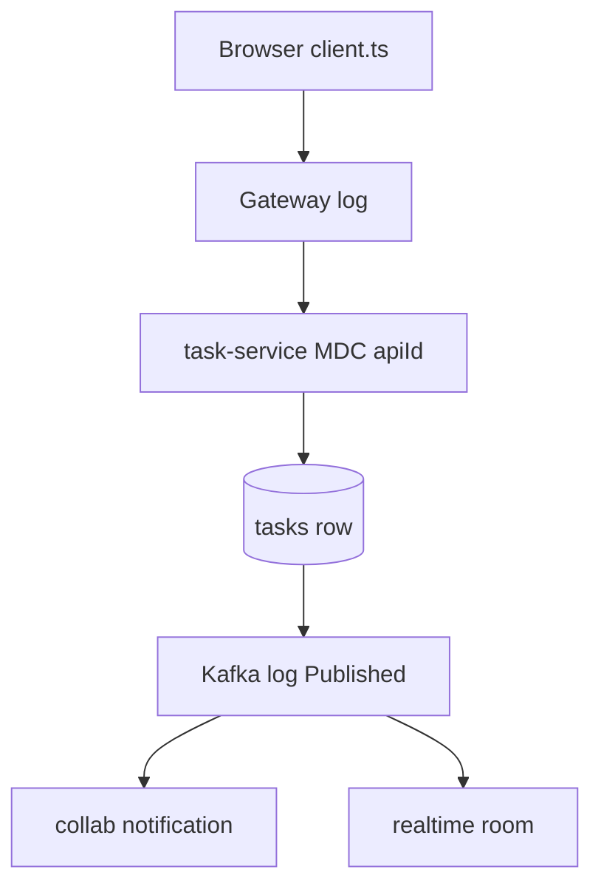

# 14 — Working in the project

**Goal:** Know where to look, how to trace one request, and what to update so the slim MVP docs stay true.

## Where things live

| You want | Open |
|----------|------|
| Ports, route map, ApiId | [docs/services-mvp.md](../services-mvp.md) and gateway `application.yml` |
| Versions | [docs/tech-stack.md](../tech-stack.md), `backend/java-services/build.gradle`, `go.mod` |
| Tables | [docs/database.md](../database.md) ownership section first, then Flyway or the Go model |
| How to start | [docs/running.md](../running.md), `scripts/dev-backend.ps1` |
| What the browser must send | [docs/fe-contract.md](../fe-contract.md), `frontend/lib/api/client.ts` |
| A Java endpoint | `*Controller.java` with the `@ApiId` |
| The business rule | `service/impl/*ServiceImpl.java` or Go `internal/service` |
| A Kafka topic | Java `*KafkaPublisher.java` or collab `internal/kafka` |
| Shared JSON types | `backend/java-services/common` |
| Old 16-service plan | `docs/archive/`. Do not implement from it. |
| This reading guide | `docs/learning/` |

Search for the ApiId string (`TASK-007`, `ORG-001`) before you search for a path. The id is on the method and in the log MDC.

## Trace a request

Example: a member assigns a task and the assignee does not see a notification.

1. Browser. Confirm `NEXT_PUBLIC_API_BASE_URL` is the gateway (`http://localhost:8080`), and the call sends `X-API-Key`, `Authorization`, and `X-Organization-Id`. The client is `frontend/lib/api/client.ts`. The assign function is in `frontend/lib/api/tasks.ts`.
2. Gateway. `logs/backend/gateway.log` (if started by the script) or the gateway console. 401 means JWT or API key. 403 with “Read-only impersonation” means an `actor` claim. Route `task-service` must point at 8083.
3. task-service. Log line includes `apiId=TASK-007`. `TaskController` then `TaskServiceImpl`. If membership fails, the org header does not match `organization_members`.
4. Database. `tasks.assignee_id` changed. If it did, the HTTP side succeeded.
5. Kafka. After commit, `TaskKafkaPublisher` logs `Published task.assigned`. If that line is missing, the listener did not run or send failed (it logs an error and does not fail the HTTP call).
6. collab. Process must be up **before** the assign if you need that message (`LastOffset`). Group `collab-service`. `NotificationService.HandleTaskAssigned` writes `notifications`. A duplicate `event_id` in `processed_events` means it already ran.
7. Mail. Assignment uses `email.StubSend` inside collab, not `email.send`. Looking in MailHog will not show assignment mail. Invitation and verify mail do go to MailHog when email-service is running and `EMAIL_SERVICE_ENABLED=true`.
8. Live board. That depends on `task.updated`, realtime, Redis, and a socket subscribed to `project:{id}` or `task:{id}`. `task.assigned` alone does not move the board.

Health before a long debug: `GET /api/v1/auth/health` on port 8080 with the API key, plus direct health on 9081, 9082, and 9084. Compose: `docker compose ps` in `backend/infrastructure`.

## When you change something

| Change | Also update |
|--------|-------------|
| New or renamed HTTP path | Controller, gateway `application.yml` if the prefix is new, [docs/services-mvp.md](../services-mvp.md) ApiId table, frontend `lib/api` if the UI calls it, this chapter’s API file if you want the guide to match |
| New table or column | Flyway in the owning Java service, or the Go model if that service owns it, and [docs/database.md](../database.md) in the same change. Do not add a second Flyway history for the same table. |
| New Kafka topic | Producer after a successful write, consumer if something must happen, topic table in [docs/services-mvp.md](../services-mvp.md) |
| New env var | `.env.example` name only, [docs/running.md](../running.md) if operators must set it. No secret values in YAML or in `docs/learning`. |
| Auth header or org rule | [docs/fe-contract.md](../fe-contract.md) |
| Version bump | [docs/tech-stack.md](../tech-stack.md) wins over older docs |

Stay inside the slim set: auth, user, platform, task, gateway, collab, realtime, document, email. Do not add a new deployable to match the archived 16-service plan.

Shared database means a migration in platform is visible to task and to Go on next connect. Order matters: auth Flyway before user-service, because user-service only validates `users`.

## Safe places to start

| Goal | Start here |
|------|------------|
| Understand a bug in login | `AuthServiceImpl.login` and chapter 06 |
| Add a field on a task | `Task` entity, task Flyway, `TaskResponse`, `docs/database.md` |
| New side effect of an existing event | Go consumer. Do not publish a second topic if `task.updated` or `task.assigned` already exists. |
| New admin screen | ApiId in the catalog, master-admin check in the service, `frontend/lib/api/admin.ts` |
| Explain the system to someone new | This folder, in the order in [README.md](README.md) |

## Profiles you can boot

From [docs/running.md](../running.md):

| Goal | Processes |
|------|-----------|
| Login only | Infra, auth, gateway |
| Hierarchy and tasks | Plus platform and task |
| Admin and mail | Plus user, email, MailHog |
| Inbox and invites | Plus collab |
| Live board | Plus realtime and Redis |
| Files | Plus document-service |

## Glossary

| Term | Meaning |
|------|---------|
| MDC `apiId` | The `@ApiId` value on the Java method that handled the request. |
| LastOffset | Go consumers start at the end of the topic. Old messages are skipped. |
| Contract first | Change `docs/services-mvp.md` or `docs/database.md` with the code, not afterwards in a separate undocumented way. |

## Unverified

Log file names inside `logs/backend/` were taken from the script’s described layout (`gateway.log`, and one file per service). If a line is missing, the process may have been started by hand in a terminal instead of `scripts/dev-backend.cmd`. The logger configuration for the exact MDC pattern is `logback-spring.xml` in each Java service; the pattern string was not copied here.
